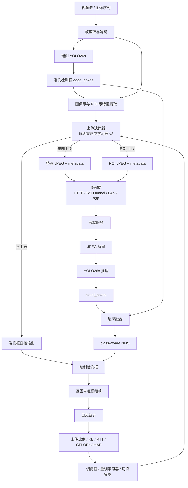
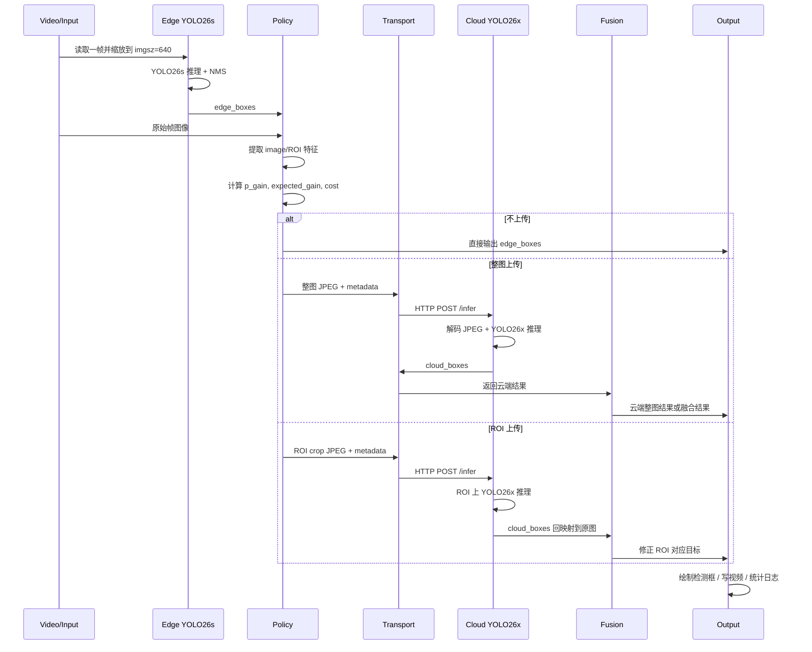
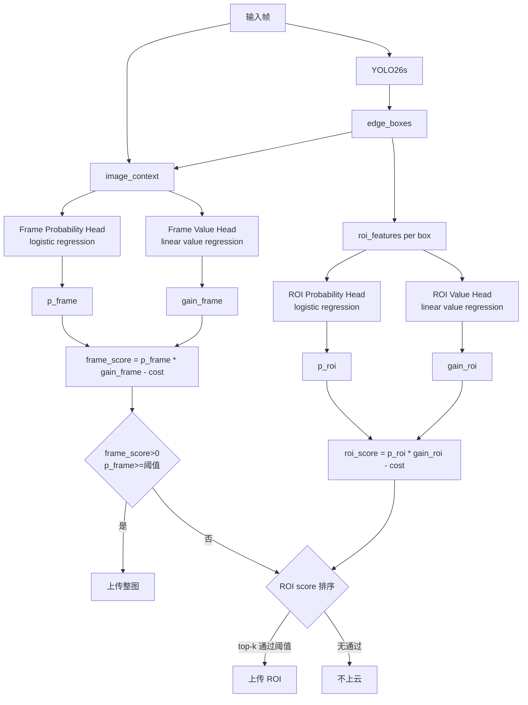
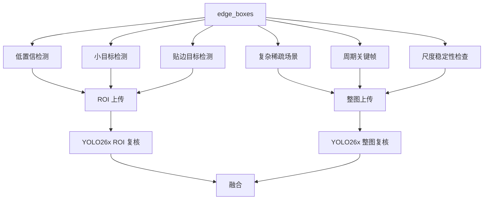

# YOLO26 端云协同目标检测架构、上传协议与延迟分析

本文档说明当前 YOLO26 端云协同目标检测系统的设计逻辑、上传内容、学习器 v2 架构、完整处理链路、融合策略、延迟拆解和当前 COCO full 测试结果。

当前默认配置：

```text
端侧模型: YOLO26s
云端模型: YOLO26x
上传学习器: learned uploader v2
默认工作点: frame_threshold=0.60, roi_threshold=0.08, cloud_imgsz=512
策略目标: 在 mAP、带宽、RTT、云端 GFLOPs 和端侧实时性之间折中
```

## 1. 为什么端云协同 mAP 可以高于 Cloud-only YOLO26x

### 1.1 先明确一个核心概念

`Cloud-only YOLO26x` 不是端云协同系统的理论最大值。它只是一个单模型基线：

```text
Cloud-only = 每一张图都只用 YOLO26x 的输出
```

端云协同不是“YOLO26x 的子集”，而是一个选择性组合系统：

```text
不上云的帧: 使用 YOLO26s 输出
上云的帧: 使用 YOLO26x 输出或 ROI 云端复核结果
```

因此，端云协同的输出空间包含两类结果：

```text
YOLO26s 的结果 + YOLO26x 的结果 + 二者融合后的结果
```

只要 YOLO26s 和 YOLO26x 的错误不完全重合，选择性组合就可能超过单独 YOLO26x。

### 1.2 为什么“更大的模型”不一定每张图都更好

YOLO26x 整体更强，但不代表它在每一张图、每一个类别、每一个 IoU 阈值上都严格优于 YOLO26s。实际检测中会出现：

- YOLO26x 在小目标上召回更好；
- YOLO26x 在复杂背景中可能多出高置信误检；
- YOLO26s 在某些简单目标上框更稳；
- 两个模型的类别错误不完全一样；
- 两个模型的置信度排序不同，而 mAP 与置信度排序有关；
- mAP50-95 对定位质量敏感，某些框 YOLO26s 可能比 YOLO26x 更贴合。

所以“模型大”表示平均能力更强，不表示它支配另一个模型的所有预测。

### 1.3 一个简化例子

假设只有 2 张图，每张图各 1 个目标：

| 图像 | YOLO26s 端侧结果 | YOLO26x 云端结果 | 最优选择 |
| --- | --- | --- | --- |
| 图 A，小目标、遮挡 | 漏检 | 检出正确 | 用 YOLO26x |
| 图 B，简单大目标、背景干扰 | 检出正确 | 把背景误检成目标，且目标框偏 | 用 YOLO26s |

如果使用 Cloud-only：

```text
图 A: 正确
图 B: 错误或质量较差
```

如果使用端云协同选择器：

```text
图 A: 上传云端，用 YOLO26x
图 B: 不上传，保留 YOLO26s
```

最终组合结果就可能比 Cloud-only 更好。

这不是违反直觉，而是典型的“模型互补 + 样本选择”效果。真正的上界不是 `YOLO26x`，而是“如果能为每张图选择更合适的检测器，或者融合两个检测器的互补预测，最多能到哪里”。

### 1.4 再举一个分类错误例子

假设某张图里有一只 `dog`：

| 模型 | 输出 |
| --- | --- |
| YOLO26s | `dog 0.78`，框位置正确 |
| YOLO26x | `cat 0.81`，框位置正确但类别错 |

Cloud-only 会把这个目标算成分类错误。端云协同如果学习器判断这张图上云收益不高，保留 YOLO26s，则该目标反而正确。

同理，也可能出现反过来的情况：YOLO26s 把 `bus` 识别成 `truck`，YOLO26x 能修正类别。这时学习器应该上传。

### 1.5 mAP 不是简单的“检测数量平均”

mAP 受这些因素共同影响：

- 每个类别的 TP/FP 排序；
- 检测框置信度；
- IoU 阈值从 0.50 到 0.95 的表现；
- 是否存在高置信误检；
- 是否漏掉目标；
- 融合后是否做 NMS。

所以一个系统即使 Recall 低于 Cloud-only，也可能 Precision 更高、误检更少、排序更好，从而 mAP50-95 更高。

当前 COCO full v2 结果中：

| 模式 | Precision | Recall | mAP50 | mAP50-95 |
| --- | ---: | ---: | ---: | ---: |
| Edge-only YOLO26s | 0.6913 | 0.5781 | 0.6346 | 0.4733 |
| Cloud-only YOLO26x | 0.7383 | 0.6700 | 0.7327 | 0.5656 |
| Learned v2 f0.50/r0.05 | 0.7835 | 0.6202 | 0.7251 | 0.5918 |
| Learned v2 f0.60/r0.08 | 0.7758 | 0.6092 | 0.7163 | 0.5829 |

可以看到，协同策略的 Recall 低于 Cloud-only，但 Precision 更高，说明它更保守地选择了高价值样本，减少了一部分云端误检或低价值输出。

### 1.6 需要注意的评估口径

当前表中有两个容易混淆的概念：

- `Cloud-only YOLO26x`: 单独使用 YOLO26x 的云端模型指标。
- `Learned v2`: 部署式选择性输出，即一部分帧用 YOLO26s，一部分帧用 YOLO26x。

因此 Learned v2 高于 Cloud-only，并不表示 YOLO26s 比 YOLO26x 强，也不表示云端模型没用。它表示：

```text
在这个数据集和阈值下，选择性端云组合优于“所有图都只用 YOLO26x”。
```

另外，`full_frame_fusion_upper` 是 GT-aware oracle，只用于分析 edge/cloud 候选框集合中潜在正确信号，不是可部署结果，不能和 Learned v2 混为一谈。

如果要做最严格的论文表格，建议补充两个同口径基线：

```text
Cloud-only YOLO26x, deployment conf=0.25
Edge-only YOLO26s, deployment conf=0.25
```

这样可以和当前协同输出的部署阈值完全对齐。

## 2. 端云协同到底上传什么

当前通信协议在 `protocol.py` 和 `edge_client.py` 中实现。它使用简单可检查的 JSON + base64 JPEG 格式。

### 2.1 上传 payload 总体结构

每次上传到云端的数据结构：

```json
{
  "metadata": {
    "task_id": "...",
    "frame_id": 123,
    "timestamp": 1710000000.0,
    "payload_type": "keyframe",
    "reason": ["learned_full_frame"],
    "upload_score": 0.62,
    "crop_xyxy": null,
    "orig_shape": [720, 1280],
    "edge_boxes": [...],
    "target_edge_box": null,
    "payload_bytes": 64000,
    "cloud_imgsz": 512
  },
  "image_b64": "..."
}
```

`image_b64` 是 JPEG 编码后的图像或 ROI crop。当前不是上传原始视频流，也不是上传模型权重、特征图或 GT 标签。

### 2.2 上传图像内容

当前支持以下几类：

| payload_type | 上传内容 | 触发原因 | 云端作用 |
| --- | --- | --- | --- |
| `keyframe` | 整张图 JPEG | 学习器判断整图上云有收益、周期关键帧、复杂场景探测 | 让 YOLO26x 对整帧重新检测，主要补漏检和整体修正 |
| `roi` | 检测框周围 crop JPEG | 某个端侧检测框低置信、小目标、贴边或学习器认为 ROI 有收益 | 让 YOLO26x 复核局部目标，修正类别/框位置 |
| `proposal` | 低置信候选框 crop | 实验性低置信候选策略 | 尝试找回被部署阈值过滤掉的目标 |
| `tile` | 未覆盖复杂区域 crop | 实验性 tile probe | 尝试补复杂区域漏检 |

当前正式推荐主要使用：

```text
learned full-frame upload + 少量 learned ROI upload
```

在 COCO full v2 的推荐点 `f0.60/r0.08` 下，上传以整图为主：

```text
uploads_submitted = 2124
uploaded_image_ratio = 0.4248
roi_uploads = 5
keyframe_uploads = 2119
```

这说明当前收益主要来自“选择性整图云端复核”，不是 ROI-only。

### 2.3 metadata 中各字段作用

| 字段 | 含义 | 作用 |
| --- | --- | --- |
| `task_id` | 单次上传任务 ID | 日志追踪、响应匹配 |
| `frame_id` | 视频帧编号 | 将云端结果映射回原始帧 |
| `timestamp` | 上传时间 | 计算时延和日志排序 |
| `payload_type` | `keyframe` / `roi` / `proposal` / `tile` | 云端和融合模块判断如何处理 |
| `reason` | 上传原因列表 | 分析策略触发来源 |
| `upload_score` | 规则分数或学习器概率 | 日志解释 |
| `crop_xyxy` | ROI 在原图中的坐标 | 云端 ROI 检测框回映射到原图 |
| `orig_shape` | 原图高宽 | 坐标恢复和边界裁剪 |
| `edge_boxes` | 当前端侧检测框 | 融合、错误分析、ROI 匹配 |
| `target_edge_box` | ROI 对应的端侧目标框 | ROI 复核时定位待修正目标 |
| `payload_bytes` | JPEG 字节数 | 统计带宽和估计上传耗时 |
| `cloud_imgsz` | 云端推理输入尺寸 | 按请求控制 YOLO26x 推理成本 |
| `learned_prob` | 学习器收益概率 | 解释学习器为什么上传 |
| `learned_expected_gain` | 学习器收益大小估计 | 解释上传价值 |
| `learned_decision` | 最终收益-成本分数 | 判断是否超过上传门槛 |
| `estimated_kb` | 预计上传 KB | 成本项 |
| `roi_gain` | ROI 扩展倍数 | 小目标/贴边目标需要更大上下文 |

### 2.4 云端返回什么

云端返回：

```json
{
  "status": "ok",
  "task_id": "...",
  "frame_id": 123,
  "payload_type": "keyframe",
  "cloud_imgsz": 512,
  "cloud_boxes": [
    {
      "xyxy": [x1, y1, x2, y2],
      "conf": 0.83,
      "cls": 0,
      "name": "person"
    }
  ],
  "cloud_latency_ms": 25.0,
  "model": "yolo26x.pt"
}
```

如果是 ROI 上传，云端会先在 crop 上检测，然后根据 `crop_xyxy` 把坐标平移回原图坐标系。

## 3. 系统总体闭环架构



这个闭环不是简单“端侧不行就丢给云端”。它包含：

- 端侧快速检测；
- 样本难度估计；
- 上传收益估计；
- 上传成本估计；
- 云端复核；
- 结果融合；
- 日志反馈和策略再优化。

## 4. 单帧从输入到输出的完整过程



### 4.1 帧读取与解码

输入可以是：

- 摄像头；
- 视频文件；
- 图像目录；
- COCO/自定义数据集清单。

该阶段主要成本包括：

- 摄像头采集延迟；
- 视频解码；
- 图像读盘；
- BGR/RGB 转换。

当前离线成本表没有计入 Gradio 浏览器事件调度和最终视频编码写盘，因此正式部署延迟应以 OpenCV 客户端为准。

### 4.2 端侧检测

端侧运行 `YOLO26s`：

```text
输入: 当前帧
输出: edge_boxes = [xyxy, conf, cls, name]
```

作用：

- 给用户一个实时可用的检测结果；
- 为上传学习器提供特征；
- 为 ROI 裁剪和融合提供基准框。

当前 COCO full 中端侧平均推理：

```text
YOLO26s edge latency ≈ 16-19 ms / image
YOLO26s GFLOPs ≈ 22.8
```

### 4.3 特征提取

学习器不会看整张图的深度特征，而是从端侧检测结果中提取轻量结构化特征。

图像级特征：

- 图像复杂度 `image_complexity`；
- 检测数量 `det_count`；
- 检测覆盖率 `coverage`；
- 最大/平均/最小置信度；
- 置信度方差；
- 是否空场景；
- 是否稀疏；
- 小目标比例；
- 低置信目标比例；
- 贴边框比例。

ROI 级特征：

- 目标置信度；
- 反置信度；
- 相对平均置信度；
- 目标面积；
- log 面积；
- 宽高比；
- 贴边程度；
- 是否小目标；
- 是否贴边；
- 中心位置；
- 目标面积在所有检测覆盖中的占比；
- 图像复杂度；
- 检测数量；
- 检测覆盖率。

### 4.4 上传决策

学习器 v2 对整图和 ROI 分别打分。

整图分支：

```text
输入: image context features
输出: 是否上传整图
主要解决: 端侧漏检、复杂场景、整体判断不可靠
```

ROI 分支：

```text
输入: box features + image context
输出: 是否上传某个 ROI
主要解决: 单个目标低置信、小目标、贴边、类别不确定
```

在线打分：

```text
score = p_gain * expected_gain - lambda * estimated_payload_KB / 100
```

如果：

```text
p_gain >= threshold
score > 0
```

则上传。

默认工作点：

```text
frame_threshold = 0.60
roi_threshold = 0.08
cost_weight = 0.02
cloud_imgsz = 512
```

### 4.5 JPEG 编码与传输

如果决定上传：

- 整图上传：编码整张图为 JPEG；
- ROI 上传：先裁剪 ROI，再编码 JPEG；
- metadata 与 JPEG base64 一起放入 JSON；
- 通过 HTTP POST 到 `/infer`。

当前实现选择 JSON + base64 是为了易调试。正式部署可以优化为：

- multipart/form-data；
- gRPC；
- ZeroMQ；
- WebRTC data channel；
- P2P QUIC；
- 消息队列。

### 4.6 云端复核

云端服务流程：

```text
接收 JSON -> 解析 metadata -> base64 解码 -> JPEG 解码 -> YOLO26x 推理 -> 返回 cloud_boxes
```

云端可根据 `cloud_imgsz` 动态控制推理尺寸：

```text
cloud_imgsz=512: 当前默认
cloud_imgsz=640: 更高计算成本，不一定更高收益
cloud_imgsz=416: 更省算力，但 full COCO 上当前不是默认
```

### 4.7 融合

整图上传：

- 当前离线学习器评估中，整图上传后主要采用云端结果作为该帧最终结果；
- 在线 Gradio 中支持 `full_frame_fusion_boxes()`，可以在 edge/cloud 同类匹配时保留更高置信结果，类别冲突时优先云端修正。

ROI 上传：

- 云端 ROI 检测框先平移回原图坐标；
- 如果与目标端侧框匹配，替换或修正该框；
- 如果未匹配但云端置信度足够高，可以补充 ROI 内漏检框；
- 最终做 class-aware NMS。

## 5. 学习器 v2 详细架构



### 5.1 v2 训练阶段

训练时需要 GT，但 GT 只用于生成学习器监督标签：

```text
1. 在 train2017 上跑 YOLO26s，得到 edge result
2. 在 train2017 上跑 YOLO26x，得到 cloud result
3. 与 GT 比较，计算 utility
4. 计算上云前后的 gain
5. 训练 probability head 和 value head
```

效用函数：

```text
utility = TP - fp_penalty * FP
gain = utility(after cloud/fusion) - utility(edge-only)
```

标签：

```text
gain > utility_margin -> 正样本
gain <= utility_margin -> 负样本
```

v2 还加入：

- train/val split；
- feature noise；
- class balance；
- Huber value regression；
- gain normalizer。

### 5.2 v1 与 v2 对比

| 项目 | v1 | v2 |
| --- | --- | --- |
| 目标 | 学是否有收益 | 学是否有收益 + 收益大小 |
| 模型 | frame/ROI 两个 logistic head | frame/ROI probability head + value head |
| 打分 | `p_gain - lambda * cost` | `p_gain * expected_gain - lambda * cost` |
| 特征 | 基础置信度、面积、复杂度 | 增加相对置信度、置信度方差、覆盖占比、低置信比例、小目标比例 |
| 泛化 | 较弱 | train/val split + noise regularization |
| 决策含义 | “可能有用就上传” | “收益超过成本才上传” |

v2 的本质改进：

```text
从二分类上传器 -> 资源约束下的收益-成本决策器
```

## 6. 规则策略架构

规则策略不需要训练，适合冷启动和 fallback。



规则策略组成：

| 模块 | 作用 | 优点 | 缺点 |
| --- | --- | --- | --- |
| low-conf ROI | 低置信框上云复核 | 简单可解释 | 低置信不一定代表云端有收益 |
| small-object ROI | 小目标上云复核 | 适合小目标不稳定 | ROI 上下文不足时可能误检 |
| edge-area ROI | 贴边目标扩大 ROI | 防止目标被裁断 | 上传 crop 可能仍缺上下文 |
| keyframe | 周期整图复核 | 能补漏检 | 上传固定，成本高 |
| complexity probe | 复杂但检测稀疏时整图上传 | 针对漏检 | 阈值依赖场景 |
| temporal memory | 稳定目标不重复上传 | 降低视频重复成本 | 需要维护 track 状态 |

规则策略的价值在于可解释和冷启动，但 COCO full 上不如 v2 学习器。

## 7. 延迟拆解

从接收视频到返回带框视频，可分为同步阻塞和异步两种口径。

### 7.1 同步阻塞

必须等云端结果回来再输出最终带框帧：

```text
T_blocking =
T_capture_decode
+ T_edge_yolo26s
+ T_feature_policy
+ T_jpeg_encode
+ T_upload_transfer
+ T_RTT
+ T_cloud_decode
+ T_cloud_yolo26x
+ T_response_decode
+ T_fusion_nms
+ T_draw_encode
```

当前成本表中的核心估计：

```text
T_est =
T_edge
+ payload_KB_per_image * 8 / uplink_Mbps
+ upload_ratio * RTT
+ upload_ratio * T_cloud
```

没有计入：

- 摄像头硬件采集；
- 浏览器/Gradio 调度；
- 最终视频编码写盘；
- 多线程队列等待；
- 服务端排队。

### 7.2 异步输出

真实部署更推荐异步：

```text
第一阶段: 先输出端侧 YOLO26s 检测框
第二阶段: 云端结果返回后修正对应帧或后续 track
```

异步口径：

```text
T_immediate ≈ T_capture_decode + T_edge_yolo26s + T_policy + T_draw
T_cloud_update ≈ T_jpeg_encode + T_upload_transfer + RTT + T_cloud_yolo26x + T_fusion
```

这样用户首先看到的是低延迟端侧结果，云端只做延迟校正。

### 7.3 当前默认点的延迟

默认：

```text
Learned v2 f0.60/r0.08
cloud_imgsz = 512
uploaded_image_ratio = 0.4248
avg payload per uploaded frame = 62.50 KB
payload per input image = 26.55 KB
edge latency = 18.61 ms
cloud latency per uploaded frame = 25.00 ms
```

不同网络下：

| 网络 | Edge | Upload | RTT 均摊 | Cloud 均摊 | Blocking E2E |
| --- | ---: | ---: | ---: | ---: | ---: |
| 2 Mbps / 100 ms RTT | 18.6 | 106.2 | 42.5 | 10.6 | 177.9 ms |
| 5 Mbps / 80 ms RTT | 18.6 | 42.5 | 34.0 | 10.6 | 105.7 ms |
| 10 Mbps / 50 ms RTT | 18.6 | 21.2 | 21.2 | 10.6 | 71.7 ms |
| 50 Mbps / 20 ms RTT | 18.6 | 4.2 | 8.5 | 10.6 | 42.0 ms |

单个上传帧在 10 Mbps / 50 ms RTT 下：

```text
T_uploaded_frame ≈ 18.6 + 62.5*8/10 + 50 + 25.0
                 ≈ 143.6 ms
```

不上云帧：

```text
T_non_uploaded_frame ≈ 18.6 ms
```

平均：

```text
Average ≈ 0.4248 * 143.6 + 0.5752 * 18.6
        ≈ 71.7 ms
```

所以平均延迟低于单个上传帧延迟，是因为不是每帧都上云。

## 8. 当前 COCO full v2 实验结果

| 策略 | Precision | Recall | mAP50 | mAP50-95 | 上传图像比 | KB/image | GFLOPs/image | E2E@10Mbps |
| --- | ---: | ---: | ---: | ---: | ---: | ---: | ---: | ---: |
| Edge-only YOLO26s | 0.6913 | 0.5781 | 0.6346 | 0.4733 | 0 | 0 | 22.8 | 18.2 ms |
| Cloud-only YOLO26x | 0.7383 | 0.6700 | 0.7327 | 0.5656 | 1.0 | 全图 | 209.5 | 取决于网络 |
| Rule aggressive | 0.7318 | 0.5832 | 0.6817 | 0.5486 | 0.6406 | 22.94 | 168.1 | 84.1 ms |
| Learned v1 f0.60/r0.08 | 0.7622 | 0.6108 | 0.7071 | 0.5744 | 0.6686 | 34.77 | 112.5 | 97.0 ms |
| Learned v2 f0.50/r0.05 | 0.7835 | 0.6202 | 0.7251 | 0.5918 | 0.5656 | 34.90 | 98.7 | 85.4 ms |
| Learned v2 f0.60/r0.08 | 0.7758 | 0.6092 | 0.7163 | 0.5829 | 0.4248 | 26.55 | 79.8 | 71.7 ms |
| Learned v2 f0.70/r0.10 | 0.7671 | 0.5919 | 0.7032 | 0.5704 | 0.2442 | 15.87 | 55.6 | 49.9 ms |
| Learned v2 f0.80/r0.10 | 0.7519 | 0.5748 | 0.6861 | 0.5518 | 0.0920 | 6.28 | 35.2 | 32.1 ms |

推荐：

```text
精度优先: v2 f0.50/r0.05
默认平衡: v2 f0.60/r0.08
弱网优先: v2 f0.70/r0.10
极低带宽: v2 f0.80/r0.10
```

## 9. 使用方式

启动云端：

```bash
conda activate yolo26
cd /home/111_wcy/work/yolo26/ultralytics-main
python examples/YOLO26-Edge-Cloud/cloud_server.py \
  --model yolo26x.pt \
  --host 0.0.0.0 \
  --port 8765 \
  --device 0
```

启动 Gradio：

```bash
python examples/YOLO26-Edge-Cloud/gradio_demo.py \
  --edge-model yolo26s.pt \
  --cloud-url http://127.0.0.1:8765/infer \
  --policy-path runs/edge_cloud/learned_policy_coco_full_v2_20260424_1225/learned_upload_policy.json \
  --learned-frame-threshold 0.60 \
  --learned-roi-threshold 0.08 \
  --cloud-imgsz 512 \
  --inbrowser
```

如果云端在远程，本地先开 SSH 隧道：

```bash
ssh -L 8765:127.0.0.1:8765 -p 10022 111_wcy@10.193.114.121
```

然后本地仍然访问：

```text
http://127.0.0.1:8765/infer
```

## 10. 后续优化方向

当前结果说明 v2 学习器有效，但仍有优化空间：

- 增加网络状态输入：`uplink_mbps`、`RTT`、队列长度、丢包率；
- 增强 temporal memory：减少视频连续帧重复整图上传；
- 重新训练 CCT/VisDrone/BDD100K 等目标域学习器；
- 改进整图融合策略，而不是整图上传后直接偏向云端结果；
- 增加同口径 Cloud-only deployment baseline；
- 将 JSON + base64 换成 multipart/gRPC/QUIC，降低协议开销；
- 在真实视频上统计端到端延迟，包括采集、绘制、编码和队列等待。
