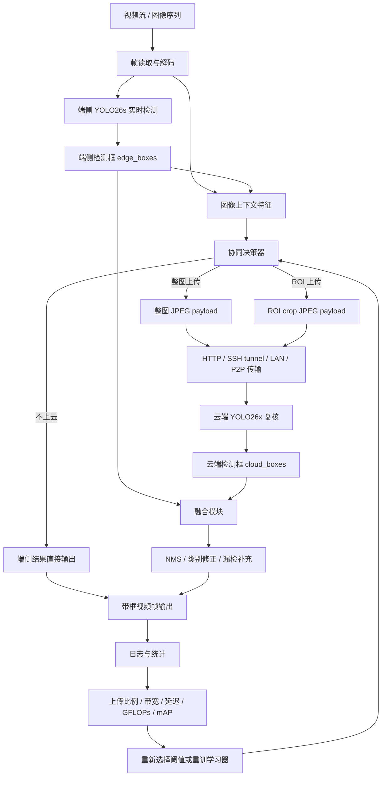
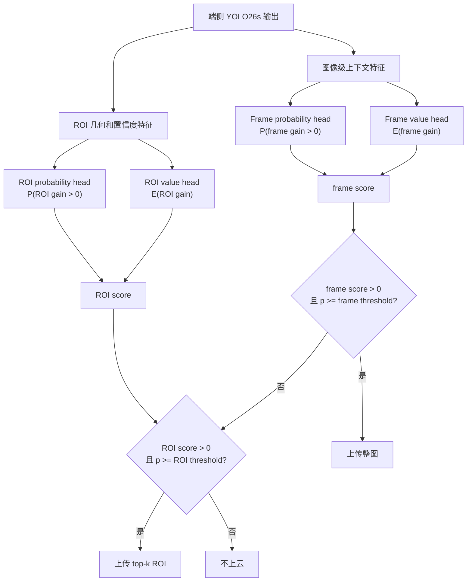

# YOLO26 端云协同目标检测架构与延迟分析文稿

## 1. 为什么端云协同 mAP 可以高于 Cloud-only YOLO26x

`Cloud-only YOLO26x` 不是端云协同系统的理论上限。它只表示“每张图都只使用 YOLO26x 的单模型结果”。端云协同使用的是一个选择性混合系统：

```text
未上传图像: 使用 YOLO26s 端侧结果
上传图像: 使用 YOLO26x 云端结果或 ROI 复核结果
```

因此它更接近一个 mixture-of-experts：学习器选择“YOLO26x 更可能修正 YOLO26s 的样本”上云；对“YOLO26s 已经更稳定或云端收益不高的样本”保留端侧结果。只要两个模型的错误并不完全重合，选择性混合就可能超过单独使用 YOLO26x。

当前 COCO full v2 中：

| 模式 | Precision | Recall | mAP50 | mAP50-95 |
| --- | ---: | ---: | ---: | ---: |
| Edge-only YOLO26s | 0.6913 | 0.5781 | 0.6346 | 0.4733 |
| Cloud-only YOLO26x | 0.7383 | 0.6700 | 0.7327 | 0.5656 |
| Learned v2 f0.50/r0.05 | 0.7835 | 0.6202 | 0.7251 | 0.5918 |
| Learned v2 f0.60/r0.08 | 0.7758 | 0.6092 | 0.7163 | 0.5829 |

这不是因为推理时用了 GT。当前 v2 是在 COCO `train2017` 上训练上传器，在 `val2017` 上评估。训练阶段用 GT 生成“上云是否有收益”的监督标签；推理和评估阶段只使用图像、端侧检测结果和学习器输出。

需要特别区分：

- `Cloud-only YOLO26x`: 可部署的单模型云端结果。
- `Learned v2`: 可部署的选择性端云结果。
- `full_frame_fusion_upper`: GT-aware oracle，只用于分析 edge/cloud 候选框集合里有多少潜在正确信号，不是可部署方法，不能当正式系统结果。

## 2. 系统闭环架构



闭环含义：

- 端侧先保证实时输出，不依赖云端才能工作。
- 云端只处理学习器认为高价值的样本。
- 结果日志用于重新评估阈值、成本和学习器泛化能力。
- 如果换数据集或场景，应重新训练或至少校准上传器。

## 3. 学习器 v2 架构

v2 学习器不是深度网络，而是非常轻量的双分支线性模型。它不替代 YOLO，只决定是否上传。



在线打分：

```text
score = P(gain > 0 | features) * max(0, E[gain | features])
        - lambda * estimated_payload_KB / 100
```

其中：

- `P(gain > 0 | features)`：这次上云有正收益的概率。
- `E[gain | features)`：收益大小估计。
- `estimated_payload_KB`：预计上传流量。
- `lambda`：成本权重，当前默认 `0.02`。

v2 使用的主要特征：

| 分支 | 特征类型 | 作用 |
| --- | --- | --- |
| Frame | 图像复杂度、检测数、覆盖率、最大/均值/最小置信度、置信度方差、空场景、低覆盖、小目标比例 | 判断整图上云是否可能补漏检或修正整体结果 |
| ROI | 目标置信度、相对置信度、面积、log 面积、宽高比、贴边程度、中心位置、覆盖占比、图像复杂度 | 判断某个检测框是否值得 ROI 复核 |

## 4. v1 与 v2 的区别

| 项目 | v1 | v2 |
| --- | --- | --- |
| 学习目标 | 二分类：是否有收益 | 二分类 + 收益回归 |
| 在线打分 | `p_gain - lambda * cost` | `p_gain * expected_gain - lambda * cost` |
| 模型头 | frame/ROI 两个 logistic head | frame/ROI probability head + frame/ROI value head |
| 特征 | 较少的置信度、面积、复杂度特征 | 增加相对置信度、置信度方差、覆盖占比、低置信比例、小目标比例等 |
| 泛化处理 | 主要拟合训练集标签 | train/val split、feature noise、class balance、Huber value regression |
| 工程作用 | 判断“是否可能值得上传” | 判断“值不值得为这次上传付出成本” |

v2 的关键变化是从“上传概率决策”升级为“收益-成本决策”。这更符合端云协同的目标，因为低成本小收益和高成本大收益不应该用同一个概率阈值处理。

## 5. 当前策略组成

### 5.1 Edge-only

只运行 `YOLO26s`。延迟最低，带宽为 0，但漏检和分类错误更多。适合网络不可用或对实时性极端敏感的场景。

### 5.2 Cloud-only

每帧都上传整图到 `YOLO26x`。单模型精度高于 edge-only，但上传量、RTT 和云端 GFLOPs 都最高，不适合野外弱网和大规模部署。

### 5.3 规则策略

规则策略根据低置信、小目标、贴边、复杂场景、关键帧触发上传。它不需要训练，可解释性强，适合作为冷启动和 fallback。问题是阈值固定，不能准确判断“这次上传是否真的划算”。

### 5.4 学习型策略 v2

学习器从训练集上学习“端侧特征 -> 上云收益”的关系。它当前在 COCO full 上明显优于规则策略，尤其在相近或更少云端计算下获得更高 mAP。

### 5.5 Temporal memory

视频流中，同一个目标会连续出现。如果一个目标刚被云端确认且状态稳定，就暂时不重复上传；当置信度下降、位置突变、类别不一致或超过重传间隔时再上传。它主要降低视频场景中的重复带宽和云端重复计算。

### 5.6 融合策略

整图上传时，离线评估当前主要使用云端结果替换对应帧结果；ROI 上传时，云端结果用于修正目标框、类别，并可在置信度足够高时补充 ROI 内漏检框。最终再做 class-aware NMS。

## 6. 全链路延迟拆解

从“接收视频帧”到“返回带框视频帧”，有两种口径。

### 6.1 同步阻塞口径

必须等云端返回后，才输出最终带云修正的帧：

```text
T_blocking =
T_decode/capture
+ T_edge_yolo26s
+ T_policy_and_jpeg
+ T_upload_transfer
+ T_RTT
+ T_cloud_yolo26x
+ T_fusion_draw_encode
```

当前正式成本表中已经实测/估计的核心项是：

```text
T_est = T_edge + payload_KB_per_image * 8 / uplink_Mbps
        + upload_ratio * RTT
        + upload_ratio * T_cloud
```

注意：这个估计不包含摄像头采集、浏览器/Gradio 事件调度、最终视频编码写盘等 UI 开销。正式评估建议以 `edge_client.py` 或 OpenCV demo 为准，Gradio 主要用于交互展示。

### 6.2 异步口径

先返回端侧框，云端结果稍后修正：

```text
T_immediate ≈ T_decode/capture + T_edge_yolo26s + T_policy + T_draw
T_cloud_update ≈ T_upload_transfer + RTT + T_cloud_yolo26x + T_fusion
```

异步模式更符合真实部署：用户先看到端侧实时检测，云端只负责延迟修正。

## 7. 当前延迟计算

默认推荐工作点：

```text
Learned v2 f0.60/r0.08, cloud_imgsz=512
uploaded_image_ratio = 0.4248
avg payload per uploaded frame = 62.50 KB
payload per input image = 26.55 KB
edge latency = 18.61 ms
cloud latency per uploaded frame = 25.00 ms
```

不同网络下的同步阻塞平均延迟：

| 网络 | Edge | Upload transfer | RTT amortized | Cloud work | Blocking E2E |
| --- | ---: | ---: | ---: | ---: | ---: |
| 2 Mbps / 100 ms RTT | 18.6 ms | 106.2 ms | 42.5 ms | 10.6 ms | 177.9 ms |
| 5 Mbps / 80 ms RTT | 18.6 ms | 42.5 ms | 34.0 ms | 10.6 ms | 105.7 ms |
| 10 Mbps / 50 ms RTT | 18.6 ms | 21.2 ms | 21.2 ms | 10.6 ms | 71.7 ms |
| 50 Mbps / 20 ms RTT | 18.6 ms | 4.2 ms | 8.5 ms | 10.6 ms | 42.0 ms |

在 10 Mbps / 50 ms RTT 下，几个 v2 工作点的全链路估计：

| 工作点 | mAP50-95 | 上传图像比 | Edge | Upload | RTT | Cloud | Blocking E2E |
| --- | ---: | ---: | ---: | ---: | ---: | ---: | ---: |
| v2 f0.50/r0.05 | 0.5918 | 0.5656 | 16.4 | 27.9 | 28.3 | 12.8 | 85.4 ms |
| v2 f0.60/r0.08 | 0.5829 | 0.4248 | 18.6 | 21.2 | 21.2 | 10.6 | 71.7 ms |
| v2 f0.70/r0.10 | 0.5704 | 0.2442 | 18.7 | 12.7 | 12.2 | 6.3 | 49.9 ms |
| v2 f0.80/r0.10 | 0.5518 | 0.0920 | 19.7 | 5.0 | 4.6 | 2.8 | 32.1 ms |

对单个上传帧，以默认点和 10 Mbps 网络估算：

```text
T_uploaded_frame ≈ 18.6 + 62.5*8/10 + 50 + 25.0
                 ≈ 143.6 ms

T_non_uploaded_frame ≈ 18.6 ms

Average ≈ 0.4248 * 143.6 + 0.5752 * 18.6
        ≈ 71.7 ms
```

所以平均延迟低于单个上传帧延迟，是因为大约 57.5% 的帧不上云。

## 8. 当前 COCO full 测试结果

| 策略 | Precision | Recall | mAP50 | mAP50-95 | 上传图像比 | KB/image | GFLOPs/image | E2E@10Mbps |
| --- | ---: | ---: | ---: | ---: | ---: | ---: | ---: | ---: |
| Edge-only YOLO26s | 0.6913 | 0.5781 | 0.6346 | 0.4733 | 0 | 0 | 22.8 | 18.2 ms |
| Cloud-only YOLO26x | 0.7383 | 0.6700 | 0.7327 | 0.5656 | 1.0 | 全图 | 209.5 | 取决于网络 |
| Rule aggressive | 0.7318 | 0.5832 | 0.6817 | 0.5486 | 0.6406 | 22.94 | 168.1 | 84.1 ms |
| Learned v1 f0.60/r0.08 | 0.7622 | 0.6108 | 0.7071 | 0.5744 | 0.6686 | 34.77 | 112.5 | 97.0 ms |
| Learned v2 f0.50/r0.05 | 0.7835 | 0.6202 | 0.7251 | 0.5918 | 0.5656 | 34.90 | 98.7 | 85.4 ms |
| Learned v2 f0.60/r0.08 | 0.7758 | 0.6092 | 0.7163 | 0.5829 | 0.4248 | 26.55 | 79.8 | 71.7 ms |
| Learned v2 f0.70/r0.10 | 0.7671 | 0.5919 | 0.7032 | 0.5704 | 0.2442 | 15.87 | 55.6 | 49.9 ms |

结论：

- 精度优先：`v2 f0.50/r0.05`，mAP50-95 最高。
- 默认平衡：`v2 f0.60/r0.08`，精度明显高于 YOLO26x cloud-only，同时上传和计算成本更低。
- 弱网优先：`v2 f0.70/r0.10`，牺牲少量精度，显著降低上传和延迟。

## 9. 使用建议

默认 Gradio 和在线 demo 已切换到：

```text
policy = runs/edge_cloud/learned_policy_coco_full_v2_20260424_1225/learned_upload_policy.json
cloud_imgsz = 512
learned_frame_threshold = 0.60
learned_roi_threshold = 0.08
learned_cost_weight = 0.02
```

如果部署在野外弱网，应优先使用：

```text
learned_frame_threshold = 0.70
learned_roi_threshold = 0.10
```

如果是论文或展示精度优先，可以使用：

```text
learned_frame_threshold = 0.50
learned_roi_threshold = 0.05
```

如果切换到 CCT、VisDrone、BDD100K 等新数据集，建议重新训练上传学习器。规则策略可以冷启动，但学习器要适配新的类别分布、目标尺度、背景复杂度和端云模型差距。
