# YOLO26 端云协同目标检测架构、上传协议与延迟分析

本文档说明当前 YOLO26 端云协同目标检测系统的设计逻辑、上传内容、学习器 v2 架构、完整处理链路、融合策略、延迟拆解和当前 COCO full 测试结果。

当前默认配置：

```text
端侧模型: YOLO26s
云端模型: YOLO26x
上传学习器: learned uploader v2
默认工作点: frame_threshold=0.60, roi_threshold=0.08, cloud_imgsz=512
策略目标: 在 mAP、带宽、RTT、云端 GFLOPs 和端侧实时性之间折中
```

## 1. 为什么端云协同 mAP 可以高于 Cloud-only YOLO26x

### 1.1 先明确一个核心概念

`Cloud-only YOLO26x` 不是端云协同系统的理论最大值。它只是一个单模型基线：

```text
Cloud-only = 每一张图都只用 YOLO26x 的输出
```

端云协同不是“YOLO26x 的子集”，而是一个选择性组合系统：

```text
不上云的帧: 使用 YOLO26s 输出
上云的帧: 使用 YOLO26x 输出或 ROI 云端复核结果
```

因此，端云协同的输出空间包含两类结果：

```text
YOLO26s 的结果 + YOLO26x 的结果 + 二者融合后的结果
```

只要 YOLO26s 和 YOLO26x 的错误不完全重合，选择性组合就可能超过单独 YOLO26x。

### 1.2 为什么“更大的模型”不一定每张图都更好

YOLO26x 整体更强，但不代表它在每一张图、每一个类别、每一个 IoU 阈值上都严格优于 YOLO26s。实际检测中会出现：

- YOLO26x 在小目标上召回更好；
- YOLO26x 在复杂背景中可能多出高置信误检；
- YOLO26s 在某些简单目标上框更稳；
- 两个模型的类别错误不完全一样；
- 两个模型的置信度排序不同，而 mAP 与置信度排序有关；
- mAP50-95 对定位质量敏感，某些框 YOLO26s 可能比 YOLO26x 更贴合。

所以“模型大”表示平均能力更强，不表示它支配另一个模型的所有预测。

### 1.3 一个简化例子

假设只有 2 张图，每张图各 1 个目标：

| 图像 | YOLO26s 端侧结果 | YOLO26x 云端结果 | 最优选择 |
| --- | --- | --- | --- |
| 图 A，小目标、遮挡 | 漏检 | 检出正确 | 用 YOLO26x |
| 图 B，简单大目标、背景干扰 | 检出正确 | 把背景误检成目标，且目标框偏 | 用 YOLO26s |

如果使用 Cloud-only：

```text
图 A: 正确
图 B: 错误或质量较差
```

如果使用端云协同选择器：

```text
图 A: 上传云端，用 YOLO26x
图 B: 不上传，保留 YOLO26s
```

最终组合结果就可能比 Cloud-only 更好。

这不是违反直觉，而是典型的“模型互补 + 样本选择”效果。真正的上界不是 `YOLO26x`，而是“如果能为每张图选择更合适的检测器，或者融合两个检测器的互补预测，最多能到哪里”。

### 1.4 再举一个分类错误例子

假设某张图里有一只 `dog`：

| 模型 | 输出 |
| --- | --- |
| YOLO26s | `dog 0.78`，框位置正确 |
| YOLO26x | `cat 0.81`，框位置正确但类别错 |

Cloud-only 会把这个目标算成分类错误。端云协同如果学习器判断这张图上云收益不高，保留 YOLO26s，则该目标反而正确。

同理，也可能出现反过来的情况：YOLO26s 把 `bus` 识别成 `truck`，YOLO26x 能修正类别。这时学习器应该上传。

### 1.5 mAP 不是简单的“检测数量平均”

mAP 受这些因素共同影响：

- 每个类别的 TP/FP 排序；
- 检测框置信度；
- IoU 阈值从 0.50 到 0.95 的表现；
- 是否存在高置信误检；
- 是否漏掉目标；
- 融合后是否做 NMS。

所以一个系统即使 Recall 低于 Cloud-only，也可能 Precision 更高、误检更少、排序更好，从而 mAP50-95 更高。

当前 COCO full v2 结果中：

| 模式 | Precision | Recall | mAP50 | mAP50-95 |
| --- | ---: | ---: | ---: | ---: |
| Edge-only YOLO26s | 0.6913 | 0.5781 | 0.6346 | 0.4733 |
| Cloud-only YOLO26x | 0.7383 | 0.6700 | 0.7327 | 0.5656 |
| Learned v2 f0.50/r0.05 | 0.7835 | 0.6202 | 0.7251 | 0.5918 |
| Learned v2 f0.60/r0.08 | 0.7758 | 0.6092 | 0.7163 | 0.5829 |

可以看到，协同策略的 Recall 低于 Cloud-only，但 Precision 更高，说明它更保守地选择了高价值样本，减少了一部分云端误检或低价值输出。

### 1.6 需要注意的评估口径

当前表中有两个容易混淆的概念：

- `Cloud-only YOLO26x`: 单独使用 YOLO26x 的云端模型指标。
- `Learned v2`: 部署式选择性输出，即一部分帧用 YOLO26s，一部分帧用 YOLO26x。

因此 Learned v2 高于 Cloud-only，并不表示 YOLO26s 比 YOLO26x 强，也不表示云端模型没用。它表示：

```text
在这个数据集和阈值下，选择性端云组合优于“所有图都只用 YOLO26x”。
```

另外，`full_frame_fusion_upper` 是 GT-aware oracle，只用于分析 edge/cloud 候选框集合中潜在正确信号，不是可部署结果，不能和 Learned v2 混为一谈。

如果要做最严格的论文表格，建议补充两个同口径基线：

```text
Cloud-only YOLO26x, deployment conf=0.25
Edge-only YOLO26s, deployment conf=0.25
```

这样可以和当前协同输出的部署阈值完全对齐。

## 2. 端云协同到底上传什么

当前通信协议在 `protocol.py` 和 `edge_client.py` 中实现。它使用简单可检查的 JSON + base64 JPEG 格式。

### 2.1 上传 payload 总体结构

每次上传到云端的数据结构：

```json
{
  "metadata": {
    "task_id": "...",
    "frame_id": 123,
    "timestamp": 1710000000.0,
    "payload_type": "keyframe",
    "reason": ["learned_full_frame"],
    "upload_score": 0.62,
    "crop_xyxy": null,
    "orig_shape": [720, 1280],
    "edge_boxes": [...],
    "target_edge_box": null,
    "payload_bytes": 64000,
    "cloud_imgsz": 512
  },
  "image_b64": "..."
}
```

`image_b64` 是 JPEG 编码后的图像或 ROI crop。当前不是上传原始视频流，也不是上传模型权重、特征图或 GT 标签。

### 2.2 上传图像内容

当前支持以下几类：

| payload_type | 上传内容 | 触发原因 | 云端作用 |
| --- | --- | --- | --- |
| `keyframe` | 整张图 JPEG | 学习器判断整图上云有收益、周期关键帧、复杂场景探测 | 让 YOLO26x 对整帧重新检测，主要补漏检和整体修正 |
| `roi` | 检测框周围 crop JPEG | 某个端侧检测框低置信、小目标、贴边或学习器认为 ROI 有收益 | 让 YOLO26x 复核局部目标，修正类别/框位置 |
| `proposal` | 低置信候选框 crop | 实验性低置信候选策略 | 尝试找回被部署阈值过滤掉的目标 |
| `tile` | 未覆盖复杂区域 crop | 实验性 tile probe | 尝试补复杂区域漏检 |

当前正式推荐主要使用：

```text
learned full-frame upload + 少量 learned ROI upload
```

在 COCO full v2 的推荐点 `f0.60/r0.08` 下，上传以整图为主：

```text
uploads_submitted = 2124
uploaded_image_ratio = 0.4248
roi_uploads = 5
keyframe_uploads = 2119
```

这说明当前收益主要来自“选择性整图云端复核”，不是 ROI-only。

### 2.3 metadata 中各字段作用

| 字段 | 含义 | 作用 |
| --- | --- | --- |
| `task_id` | 单次上传任务 ID | 日志追踪、响应匹配 |
| `frame_id` | 视频帧编号 | 将云端结果映射回原始帧 |
| `timestamp` | 上传时间 | 计算时延和日志排序 |
| `payload_type` | `keyframe` / `roi` / `proposal` / `tile` | 云端和融合模块判断如何处理 |
| `reason` | 上传原因列表 | 分析策略触发来源 |
| `upload_score` | 规则分数或学习器概率 | 日志解释 |
| `crop_xyxy` | ROI 在原图中的坐标 | 云端 ROI 检测框回映射到原图 |
| `orig_shape` | 原图高宽 | 坐标恢复和边界裁剪 |
| `edge_boxes` | 当前端侧检测框 | 融合、错误分析、ROI 匹配 |
| `target_edge_box` | ROI 对应的端侧目标框 | ROI 复核时定位待修正目标 |
| `payload_bytes` | JPEG 字节数 | 统计带宽和估计上传耗时 |
| `cloud_imgsz` | 云端推理输入尺寸 | 按请求控制 YOLO26x 推理成本 |
| `learned_prob` | 学习器收益概率 | 解释学习器为什么上传 |
| `learned_expected_gain` | 学习器收益大小估计 | 解释上传价值 |
| `learned_decision` | 最终收益-成本分数 | 判断是否超过上传门槛 |
| `estimated_kb` | 预计上传 KB | 成本项 |
| `roi_gain` | ROI 扩展倍数 | 小目标/贴边目标需要更大上下文 |

### 2.4 云端返回什么

云端返回：

```json
{
  "status": "ok",
  "task_id": "...",
  "frame_id": 123,
  "payload_type": "keyframe",
  "cloud_imgsz": 512,
  "cloud_boxes": [
    {
      "xyxy": [x1, y1, x2, y2],
      "conf": 0.83,
      "cls": 0,
      "name": "person"
    }
  ],
  "cloud_latency_ms": 25.0,
  "model": "yolo26x.pt"
}
```

如果是 ROI 上传，云端会先在 crop 上检测，然后根据 `crop_xyxy` 把坐标平移回原图坐标系。

## 3. 系统总体闭环架构

下面这张图同时包含两部分：

- **实线主链路**：在线推理时每一帧真正走的流程。
- **虚线反馈链路**：离线分析与下一轮部署优化流程，不在实时推理中更新模型。

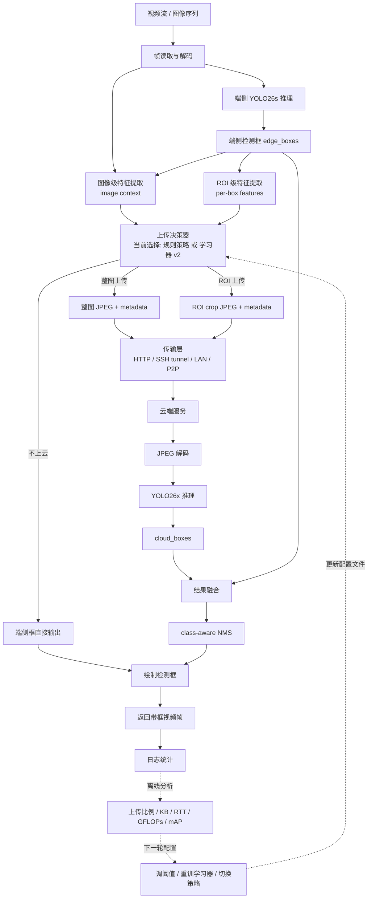

这张图不要理解成“推理时一边检测一边训练”。在线推理时，流程只走到“返回带框视频帧”和“日志统计”；日志统计只是把结果写下来。`调阈值 / 重训学习器 / 切换策略` 是离线动作，通常发生在实验结束后或部署一段时间后，由工程人员根据日志重新选择参数，或者重新训练一个新的 `learned_upload_policy.json`，然后下一次启动系统时加载新的策略。

### 3.1 在线推理主链路逐箭头解释

1. `视频流 / 图像序列 -> 帧读取与解码`  
   系统先从摄像头、视频文件、图片目录或数据集清单中取出一帧，把它解码成 OpenCV 可处理的图像矩阵。

2. `帧读取与解码 -> 端侧 YOLO26s 推理`  
   解码后的原始帧送入端侧轻量模型 YOLO26s。YOLO26s 负责实时检测，是整个系统的低延迟基础。

3. `端侧 YOLO26s 推理 -> 端侧检测框 edge_boxes`  
   YOLO26s 输出检测框、类别、置信度，即 `edge_boxes`。这些框既可以直接作为端侧输出，也会作为上传决策和融合的依据。

4. `帧读取与解码 -> 图像级特征提取`  
   图像级特征需要原始图像本身，例如图像复杂度 `image_complexity` 是通过 Canny 边缘密度从原图计算的。因此帧读取与解码必须连到图像级特征提取。

5. `端侧检测框 edge_boxes -> 图像级特征提取`  
   图像级特征不只来自原图，也来自端侧检测结果。例如检测数量、检测覆盖率、平均置信度、低置信比例、小目标比例、贴边框比例，都需要 `edge_boxes` 才能计算。

6. `端侧检测框 edge_boxes -> ROI 级特征提取`  
   ROI 级特征是针对每一个检测框计算的，例如该框置信度、面积、宽高比、是否贴边、中心位置、相对置信度等。没有 `edge_boxes` 就没有 ROI 特征。

7. `图像级特征 / ROI 级特征 -> 上传决策器`  
   上传决策器需要这两类特征来判断是否上云。整图上传主要依赖图像级特征；ROI 上传主要依赖每个框的 ROI 特征，同时也会参考图像级上下文。

8. `上传决策器 -> 不上云 / 整图上传 / ROI 上传`  
   决策器最终输出三种动作之一：不上云、整图上云、ROI 上云。这里的“决策器”是一个统一的工程模块，内部可以使用规则策略，也可以使用学习器 v2。

9. `整图或 ROI 上传 -> 传输层 -> 云端服务`  
   如果需要上云，端侧会把整图或 ROI crop 编码成 JPEG，并附带 metadata，通过 HTTP 或其他传输方式发给云端。

10. `云端服务 -> JPEG 解码 -> YOLO26x 推理 -> cloud_boxes`  
    云端解码 JPEG，用 YOLO26x 进行强模型检测，返回云端检测框。

11. `cloud_boxes + edge_boxes -> 结果融合`  
    融合模块需要同时看到端侧框和云端框。整图上传时可以使用云端结果修正整帧；ROI 上传时只修正对应局部目标。

12. `融合 -> NMS -> 绘制检测框 -> 返回带框视频帧`  
    融合后做 class-aware NMS，去掉重复框，然后把最终框画到图像上，形成带框视频帧。

13. `返回带框视频帧 -> 日志统计`  
    系统记录本帧是否上传、上传了多少 KB、云端耗时、RTT、融合事件、最终检测数量等，供后续分析。

### 3.2 为什么“帧读取与解码”要指向“图像级与 ROI 级特征提取”

更准确地说，帧读取与解码直接指向的是“图像级特征提取”，不是单独只指向 ROI 特征。原因是学习器和规则策略都需要原始图像信息：

- 图像复杂度需要原图灰度图和 Canny 边缘；
- 整图 JPEG 大小估计需要原图编码；
- ROI crop 需要从原始帧里裁剪；
- ROI 面积占比需要知道原图高宽；
- 贴边程度需要知道原图边界；
- 检测覆盖率需要把框面积除以原图面积。

因此，特征提取模块必须同时接收：

```text
原始帧图像 + 端侧 edge_boxes
```

只有原始帧，没有检测框，就无法判断哪个 ROI 可疑；只有检测框，没有原图，就无法计算图像复杂度、裁剪 ROI、估计 payload 大小。

### 3.3 离线反馈链路逐箭头解释

`日志统计 -> 上传比例 / KB / RTT / GFLOPs / mAP` 表示实验结束后读取日志和评估结果，统计系统成本与精度。它不是在线推理的一部分。

`上传比例 / KB / RTT / GFLOPs / mAP -> 调阈值 / 重训学习器 / 切换策略` 表示根据实验结果做离线决策。例如：

- 如果上传太多，就提高 `frame_threshold` 或 `roi_threshold`；
- 如果精度不够，就降低阈值或重新训练学习器；
- 如果网络很差，就切到弱网工作点 `f0.70/r0.10`；
- 如果换到 CCT 数据集，就重新训练新的学习器。

`调阈值 / 重训学习器 / 切换策略 -> 上传决策器` 表示下一次启动系统时，上传决策器加载新的阈值或新的 policy JSON。它不是实时链路中的反向传播，也不是在线训练。

### 3.4 这到底是训练架构还是推理架构

这张“系统总体闭环架构”主要是**部署/推理架构**，但在末尾附带了一个**离线优化反馈环**。为了避免混淆，可以把它拆成两句话：

```text
在线推理: 视频帧 -> YOLO26s -> 上传决策 -> 可选云端 YOLO26x -> 融合 -> 带框输出。
离线优化: 日志和评估结果 -> 分析成本/精度 -> 调阈值或重训 -> 下一次部署加载新策略。
```

实时运行时不会训练学习器，也不会自动调阈值；它只使用当前已经配置好的规则或学习器参数。

## 4. 单帧从输入到输出的完整过程

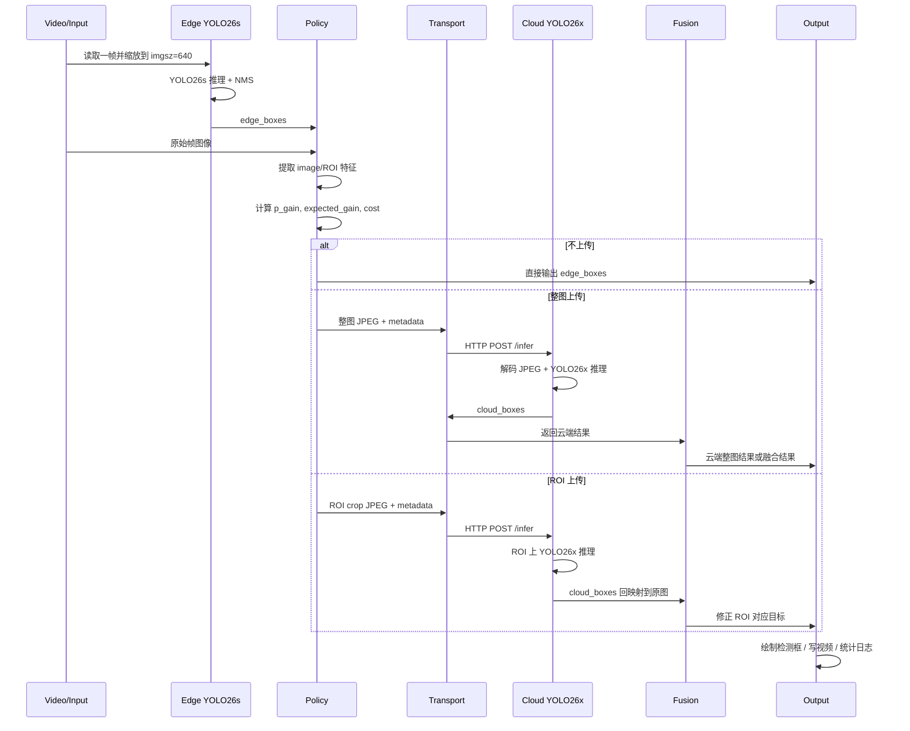

### 4.1 帧读取与解码

输入可以是：

- 摄像头；
- 视频文件；
- 图像目录；
- COCO/自定义数据集清单。

该阶段主要成本包括：

- 摄像头采集延迟；
- 视频解码；
- 图像读盘；
- BGR/RGB 转换。

当前离线成本表没有计入 Gradio 浏览器事件调度和最终视频编码写盘，因此正式部署延迟应以 OpenCV 客户端为准。

### 4.2 端侧检测

端侧运行 `YOLO26s`：

```text
输入: 当前帧
输出: edge_boxes = [xyxy, conf, cls, name]
```

作用：

- 给用户一个实时可用的检测结果；
- 为上传学习器提供特征；
- 为 ROI 裁剪和融合提供基准框。

当前 COCO full 中端侧平均推理：

```text
YOLO26s edge latency ≈ 16-19 ms / image
YOLO26s GFLOPs ≈ 22.8
```

### 4.3 特征提取

学习器不会看整张图的深度特征，而是从端侧检测结果中提取轻量结构化特征。

图像级特征：

- 图像复杂度 `image_complexity`；
- 检测数量 `det_count`；
- 检测覆盖率 `coverage`；
- 最大/平均/最小置信度；
- 置信度方差；
- 是否空场景；
- 是否稀疏；
- 小目标比例；
- 低置信目标比例；
- 贴边框比例。

ROI 级特征：

- 目标置信度；
- 反置信度；
- 相对平均置信度；
- 目标面积；
- log 面积；
- 宽高比；
- 贴边程度；
- 是否小目标；
- 是否贴边；
- 中心位置；
- 目标面积在所有检测覆盖中的占比；
- 图像复杂度；
- 检测数量；
- 检测覆盖率。

### 4.4 上传决策

学习器 v2 对整图和 ROI 分别打分。

整图分支：

```text
输入: image context features
输出: 是否上传整图
主要解决: 端侧漏检、复杂场景、整体判断不可靠
```

ROI 分支：

```text
输入: box features + image context
输出: 是否上传某个 ROI
主要解决: 单个目标低置信、小目标、贴边、类别不确定
```

在线打分：

```text
score = p_gain * expected_gain - lambda * estimated_payload_KB / 100
```

如果：

```text
p_gain >= threshold
score > 0
```

则上传。

默认工作点：

```text
frame_threshold = 0.60
roi_threshold = 0.08
cost_weight = 0.02
cloud_imgsz = 512
```

### 4.5 JPEG 编码与传输

如果决定上传：

- 整图上传：编码整张图为 JPEG；
- ROI 上传：先裁剪 ROI，再编码 JPEG；
- metadata 与 JPEG base64 一起放入 JSON；
- 通过 HTTP POST 到 `/infer`。

当前实现选择 JSON + base64 是为了易调试。正式部署可以优化为：

- multipart/form-data；
- gRPC；
- ZeroMQ；
- WebRTC data channel；
- P2P QUIC；
- 消息队列。

### 4.6 云端复核

云端服务流程：

```text
接收 JSON -> 解析 metadata -> base64 解码 -> JPEG 解码 -> YOLO26x 推理 -> 返回 cloud_boxes
```

云端可根据 `cloud_imgsz` 动态控制推理尺寸：

```text
cloud_imgsz=512: 当前默认
cloud_imgsz=640: 更高计算成本，不一定更高收益
cloud_imgsz=416: 更省算力，但 full COCO 上当前不是默认
```

### 4.7 融合

整图上传：

- 当前离线学习器评估中，整图上传后主要采用云端结果作为该帧最终结果；
- 在线 Gradio 中支持 `full_frame_fusion_boxes()`，可以在 edge/cloud 同类匹配时保留更高置信结果，类别冲突时优先云端修正。

ROI 上传：

- 云端 ROI 检测框先平移回原图坐标；
- 如果与目标端侧框匹配，替换或修正该框；
- 如果未匹配但云端置信度足够高，可以补充 ROI 内漏检框；
- 最终做 class-aware NMS。

## 5. 学习器 v2 详细架构

学习器 v2 是上传决策器的一种实现方式。它不是 YOLO 模型，也不直接输出检测框；它只回答一个问题：

```text
这张图或这个 ROI 是否值得上传到云端复核？
```

它的输入来自端侧 YOLO26s 的检测结果和原始图像统计信息，输出是上传动作建议。

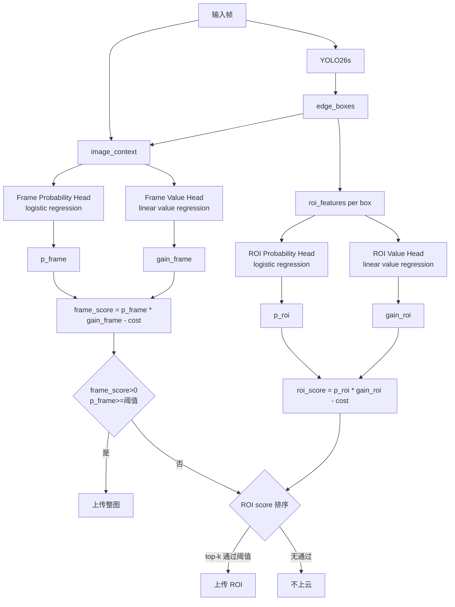

### 5.1 中文流程图：从一帧图像到上传动作

下面这张图用更接近中文业务流程的方式描述 v2：

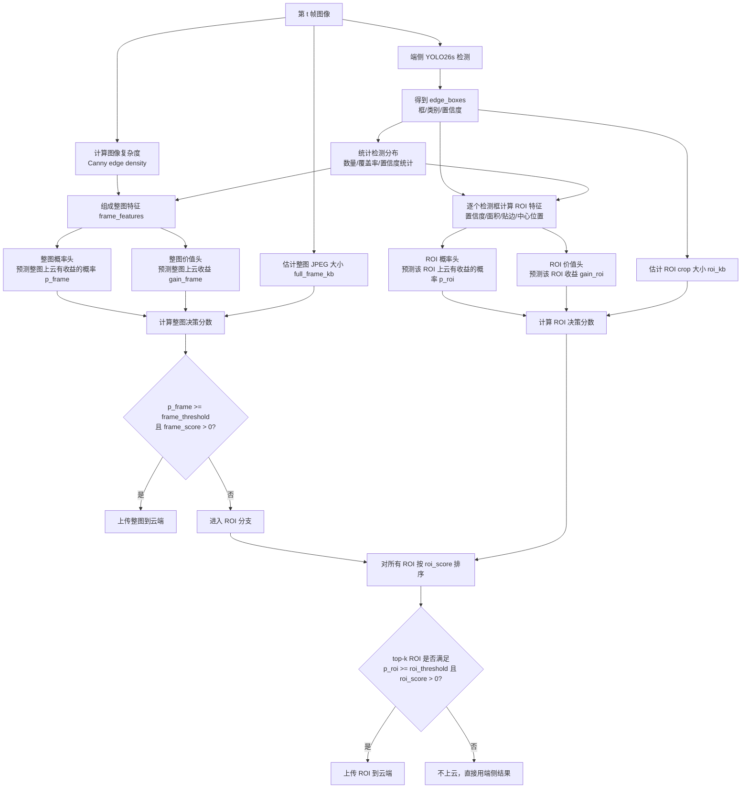

### 5.2 v2 架构逐箭头解释

1. `第 t 帧图像 -> 端侧 YOLO26s 检测`  
   每帧先由端侧模型检测，这是实时检测基础。学习器不直接看原始图像做深度推理，而是使用端侧模型输出和轻量图像统计。

2. `YOLO26s 检测 -> edge_boxes`  
   `edge_boxes` 包含每个目标框的坐标、类别、置信度。后续 ROI 特征、检测覆盖率、置信度统计都来自这里。

3. `第 t 帧图像 -> 计算图像复杂度`  
   图像复杂度来自原始图像，例如 Canny 边缘密度。复杂度高但检测少，可能说明端侧漏检。

4. `edge_boxes -> 统计检测分布`  
   统计检测数量、最大/平均/最小置信度、置信度方差、检测覆盖率、小目标比例、低置信比例等。这些描述“端侧对整帧有多自信”。

5. `图像复杂度 + 检测分布 -> frame_features`  
   这些特征合起来形成整图分支输入。整图分支判断“这一整帧是否值得云端重新看一遍”。

6. `edge_boxes -> ROI 特征`  
   对每个检测框单独提特征。例如某个框是否低置信、是否小目标、是否贴边、面积占比是多少、中心点在哪里。

7. `frame_features -> 整图概率头`  
   输出 `p_frame`，表示“整图上传后检测结果会变好的概率”。

8. `frame_features -> 整图价值头`  
   输出 `gain_frame`，表示“如果整图上传，预期能提升多少 utility”。

9. `第 t 帧图像 -> 估计整图 JPEG 大小`  
   上传成本不是固定的。复杂图、分辨率高的图 JPEG 可能更大，所以要估计 `full_frame_kb`。

10. `p_frame + gain_frame + full_frame_kb -> 整图决策分数`  
    使用公式：

```text
frame_score = p_frame * max(0, gain_frame)
              - cost_weight * full_frame_kb / 100
```

11. `整图决策分数 -> 是否上传整图`  
    如果：

```text
p_frame >= frame_threshold
frame_score > 0
```

    则上传整图。默认 `frame_threshold=0.60`。

12. `整图不上传 -> ROI 分支`  
    如果整图不值得上传，系统再检查局部检测框是否值得 ROI 复核。这样避免同一帧既整图上传又大量 ROI 上传。

13. `ROI 特征 -> ROI 概率头 / ROI 价值头`  
    每个 ROI 都会得到 `p_roi` 和 `gain_roi`。这表示某个局部框是否值得云端复核。

14. `ROI crop 大小估计 -> ROI 决策分数`  
    ROI 成本通常比整图低，但小目标会扩大上下文，贴边目标也会扩大 crop，所以 ROI 大小需要单独估计。

15. `ROI 决策分数 -> top-k 排序`  
    一帧可能有多个可疑框，系统不会全部上传，而是按 `roi_score` 排序，只保留 top-k。

16. `top-k ROI -> 上传 ROI 或不上云`  
    如果 ROI 满足：

```text
p_roi >= roi_threshold
roi_score > 0
```

    则上传。默认 `roi_threshold=0.08`。

### 5.3 学习器、决策器、规则策略是什么关系

这部分容易混淆，需要明确三个概念：

```text
上传决策器 = 工程模块/接口
规则策略 = 上传决策器的一种实现
学习器 v2 = 上传决策器的另一种实现
```

也就是说，“上传决策器”不是额外第三个模型，它是一个总称。它内部可以选择使用规则策略，也可以选择使用学习器 v2。

关系如下：

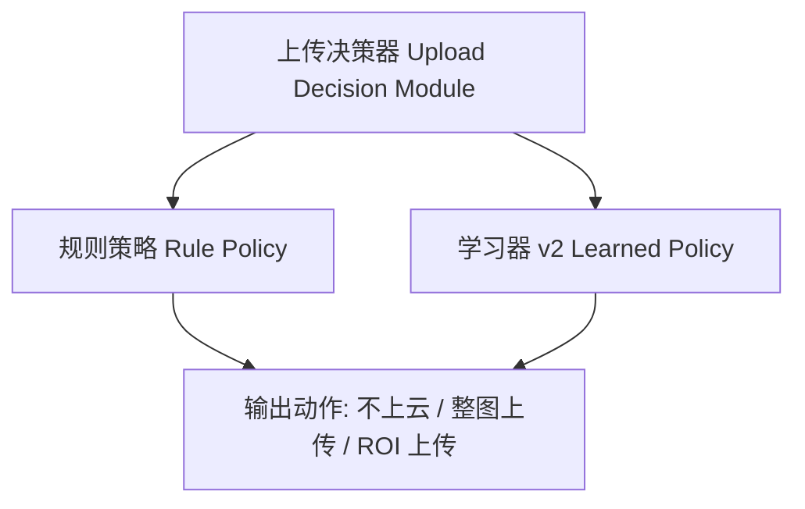

### 5.4 学习器和决策器是同时进行还是逐一进行

默认部署时不是“规则策略和学习器同时跑”，也不是“先学习器再规则决策器”。默认逻辑是二选一：

```text
如果启用 learned_policy:
    上传决策器使用学习器 v2
否则:
    上传决策器使用规则策略
```

在代码中也体现了这个逻辑：

```text
learned_policy is not None -> 使用学习器分支
learned_policy is None     -> 使用规则策略分支
```

所以当前默认系统是：

```text
上传决策器 = 学习器 v2
```

不是：

```text
学习器 -> 再经过规则策略 -> 再决定上传
```

### 5.5 为什么不只叫“学习器”，还要叫“上传决策器”

因为工程上需要一个统一接口来输出上传动作：

```text
输入: 原始帧 + edge_boxes + 当前配置
输出: 不上传 / 上传整图 / 上传 ROI
```

这个接口可以由不同策略实现：

- 没有训练数据时，用规则策略；
- 有 COCO/CCT 等训练数据时，用学习器；
- 弱网时，切换高阈值学习器工作点；
- 安全兜底时，规则策略可以作为 fallback。

因此“决策器”是系统模块，“学习器”是其中一种算法实现。

### 5.6 是否可以只使用一个

可以。实际上当前默认就是只使用学习器 v2。

保留规则策略的原因不是因为必须串联，而是：

- 规则策略不需要训练，适合冷启动；
- 学习器文件缺失或不适配新数据集时，规则策略可以兜底；
- 规则策略可解释，适合做 baseline；
- 学习器需要数据集和 GT 训练，换场景后可能需要重训。

推荐工程用法：

```text
有训练好的 policy JSON -> 用学习器 v2
没有训练好的 policy JSON -> 用规则策略
网络弱 -> 用学习器 v2 的高阈值工作点
换新数据集 -> 先规则冷启动，再收集数据重训学习器
```

### 5.7 学习器 v2 和“是否整图上传”的关系

学习器 v2 本身就包含两个分支：

```text
frame branch -> 决定是否整图上传
ROI branch   -> 决定是否 ROI 上传
```

所以不是“学习器只决定是否上云，决策器再决定整图还是 ROI”。更准确的说法是：

```text
学习器 v2 作为上传决策器，内部同时决定：
1. 是否上云；
2. 如果上云，是整图还是 ROI；
3. 如果是 ROI，上传哪个 ROI。
```

默认顺序是：

```text
先判断整图是否值得上传；
如果整图不上传，再判断 ROI 是否值得上传。
```

为什么先判断整图？

- 整图上传可以处理漏检，因为漏检目标没有 ROI；
- 如果已经整图上传，再上传 ROI 通常重复；
- 先整图后 ROI 可以避免一帧内上传过多任务。

如果某些应用特别强调局部复核，也可以改成“先 ROI 后整图”，但当前实验中 COCO full 的主要收益来自选择性整图上传，因此默认先 frame branch。

### 5.8 这和规则策略的 ROI/整图判断有什么区别

规则策略：

```text
用人工公式判断：
低置信/小目标/贴边 -> ROI
复杂稀疏/关键帧/尺度不稳定 -> 整图
```

学习器 v2：

```text
从 COCO train2017 学到：
什么样的整图上云能提升 utility；
什么样的 ROI 上云能提升 utility；
再扣除上传 KB 成本。
```

因此二者输出形式相同，都是：

```text
不上云 / 整图上传 / ROI 上传
```

但决策依据不同：

| 项目 | 规则策略 | 学习器 v2 |
| --- | --- | --- |
| 是否需要训练 | 不需要 | 需要 |
| 依据 | 人工阈值和公式 | 数据学习到的收益概率和收益大小 |
| 可解释性 | 强 | 中等，可查看特征和分数 |
| 上限 | 较低 | 较高 |
| 跨域稳定性 | 较平滑 | 需要重训或校准 |

### 5.9 v2 训练阶段

训练时需要 GT，但 GT 只用于生成学习器监督标签：

```text
1. 在 train2017 上跑 YOLO26s，得到 edge result
2. 在 train2017 上跑 YOLO26x，得到 cloud result
3. 与 GT 比较，计算 utility
4. 计算上云前后的 gain
5. 训练 probability head 和 value head
```

效用函数：

```text
utility = TP - fp_penalty * FP
gain = utility(after cloud/fusion) - utility(edge-only)
```

标签：

```text
gain > utility_margin -> 正样本
gain <= utility_margin -> 负样本
```

v2 还加入：

- train/val split；
- feature noise；
- class balance；
- Huber value regression；
- gain normalizer。

### 5.10 COCO full 上的实际训练流程

当前 COCO full v2 学习器是在 COCO `train2017` 上训练，在 COCO `val2017` 上评估。训练命令使用的是类似下面的配置：

```bash
python examples/YOLO26-Edge-Cloud/train_learned_uploader.py \
  --source /home/111_wcy/work/datasets/coco/train2017.txt \
  --edge-model yolo26s.pt \
  --cloud-model yolo26x.pt \
  --device 0 \
  --half \
  --edge-batch-size 8 \
  --cloud-batch-size 8 \
  --roi-batch-size 16 \
  --enable-adaptive-roi \
  --roi-small-gain 1.6 \
  --roi-edge-gain 1.45 \
  --roi-large-gain 1.15 \
  --feature-noise-std 0.02 \
  --gain-normalizer labels \
  --save-dir runs/edge_cloud/learned_policy_coco_full_v2_20260424_1225
```

训练过程不是训练 YOLO26s 或 YOLO26x，而是训练一个很小的“上传决策器”。YOLO26s 和 YOLO26x 权重在这个阶段不更新。

完整训练步骤如下：

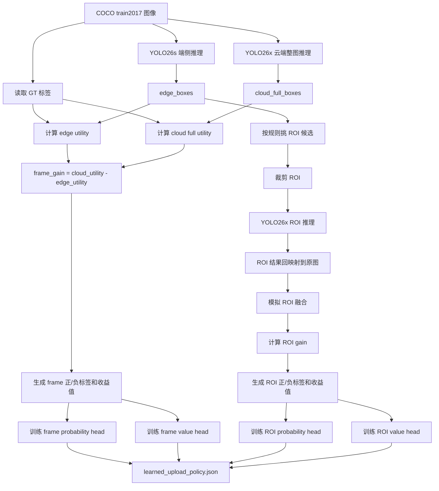

训练阶段每张图会产生两类训练样本：

| 样本类型 | 一个样本代表什么 | 输入特征 | 标签如何生成 |
| --- | --- | --- | --- |
| frame sample | 这一整张图是否值得上云 | 图像复杂度、检测数、覆盖率、置信度统计等 | 比较 `cloud full` 与 `edge-only` 的 utility |
| ROI sample | 某个端侧检测框是否值得 ROI 上云 | 该框置信度、面积、位置、贴边程度、图像上下文等 | 模拟 ROI 云端复核后比较 utility 是否提升 |

utility 的定义：

```text
utility = TP - fp_penalty * FP
```

其中：

- `TP`：预测框和 GT 同类别，且 IoU >= 0.5；
- `FP`：没有匹配到 GT 的预测框；
- `fp_penalty`：误检惩罚，当前默认 `0.25`。

为什么不用直接优化 mAP？因为 mAP 是全数据集级别指标，不容易给单张图或单个 ROI 直接生成标签。这里用 `TP - fp_penalty*FP` 作为单样本代理收益，目的是让学习器知道“这次上云是否让检测结果变好”。

gain 的定义：

```text
frame_gain = utility(cloud_full) - utility(edge_only)
roi_gain   = utility(edge_after_roi_fusion) - utility(edge_only)
```

如果启用 `gain_normalizer=labels`：

```text
normalized_gain = gain / max(1, 当前图像 GT 数量)
```

这样做是为了避免目标很多的图片天然 gain 更大，从而让学习器更关注“相对收益”。

正负样本标签：

```text
gain > utility_margin -> 正样本，表示值得上传
gain <= utility_margin -> 负样本，表示不值得上传
```

当前 `utility_margin=0.0`，表示只要 utility 有正提升，就认为有上传价值。

### 5.11 训练后得到什么

训练结束后会生成：

```text
runs/edge_cloud/learned_policy_coco_full_v2_20260424_1225/
├── learned_upload_policy.json
├── training_report.json
└── training_samples.json
```

各文件作用：

| 文件 | 作用 |
| --- | --- |
| `learned_upload_policy.json` | 在线推理加载的轻量上传器参数 |
| `training_report.json` | 训练集、正样本率、训练/验证准确率、Brier score、MAE 等报告 |
| `training_samples.json` | 每个训练样本的 gain、label、触发原因等调试信息 |

`learned_upload_policy.json` 中包含：

```text
frame_model       -> 整图上传概率头
frame_value_model -> 整图收益回归头
roi_model         -> ROI 上传概率头
roi_value_model   -> ROI 收益回归头
frame_features    -> frame 特征顺序
roi_features      -> ROI 特征顺序
metadata          -> 训练来源和参数
```

### 5.12 推理时会不会继续训练

不会。实时推理阶段只加载已经训练好的 `learned_upload_policy.json`，做一次前向计算：

```text
features -> probability head/value head -> score -> 是否上传
```

总架构图里的“调阈值 / 重训学习器 / 切换策略”是离线闭环，不是在实时推理中发生。它的意思是：

```text
部署运行 -> 记录日志和成本 -> 离线分析 -> 调阈值或重训 -> 更新 policy JSON -> 下一次部署使用
```

实时链路中不会边推理边更新权重。这样做的好处是：

- 运行稳定；
- 结果可复现；
- 不会因为在线噪声导致策略漂移；
- 适合工程部署和论文实验。

### 5.13 v1 与 v2 对比

| 项目 | v1 | v2 |
| --- | --- | --- |
| 目标 | 学是否有收益 | 学是否有收益 + 收益大小 |
| 模型 | frame/ROI 两个 logistic head | frame/ROI probability head + value head |
| 打分 | `p_gain - lambda * cost` | `p_gain * expected_gain - lambda * cost` |
| 特征 | 基础置信度、面积、复杂度 | 增加相对置信度、置信度方差、覆盖占比、低置信比例、小目标比例 |
| 泛化 | 较弱 | train/val split + noise regularization |
| 决策含义 | “可能有用就上传” | “收益超过成本才上传” |

v2 的本质改进：

```text
从二分类上传器 -> 资源约束下的收益-成本决策器
```

### 5.14 在线决策的每一步

以默认 v2 工作点为例：

```text
frame_threshold = 0.60
roi_threshold = 0.08
cost_weight = 0.02
cloud_imgsz = 512
```

对每一帧：

1. 运行 YOLO26s 得到 `edge_boxes`。
2. 提取图像级特征 `frame_features`。
3. 用 `frame_model` 输出 `p_frame`，用 `frame_value_model` 输出 `gain_frame`。
4. 估计整图 JPEG 大小 `full_frame_kb`。
5. 计算：

```text
frame_score = p_frame * max(0, gain_frame) - cost_weight * full_frame_kb / 100
```

6. 如果：

```text
p_frame >= frame_threshold
frame_score > 0
```

则上传整图。

7. 如果整图不上云，则对每个候选 edge box 提取 ROI 特征。
8. 用 ROI probability/value heads 得到 `p_roi` 和 `gain_roi`。
9. 估计 ROI crop 上传大小 `roi_kb`。
10. 计算：

```text
roi_score = p_roi * max(0, gain_roi) - cost_weight * roi_kb / 100
```

11. 选择通过阈值且 `roi_score > 0` 的 top-k ROI 上传。

这就是为什么 v2 比单纯阈值策略更合理：它不只问“这个样本有没有可能变好”，还问“为了这个可能的提升，上传这么多 KB 值不值”。

## 6. 规则策略架构

规则策略不需要训练，适合冷启动和 fallback。

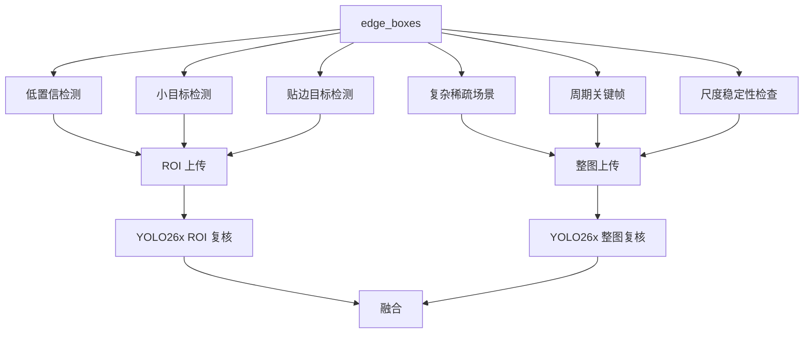

规则策略组成：

| 模块 | 作用 | 优点 | 缺点 |
| --- | --- | --- | --- |
| low-conf ROI | 低置信框上云复核 | 简单可解释 | 低置信不一定代表云端有收益 |
| small-object ROI | 小目标上云复核 | 适合小目标不稳定 | ROI 上下文不足时可能误检 |
| edge-area ROI | 贴边目标扩大 ROI | 防止目标被裁断 | 上传 crop 可能仍缺上下文 |
| keyframe | 周期整图复核 | 能补漏检 | 上传固定，成本高 |
| complexity probe | 复杂但检测稀疏时整图上传 | 针对漏检 | 阈值依赖场景 |
| temporal memory | 稳定目标不重复上传 | 降低视频重复成本 | 需要维护 track 状态 |

规则策略的价值在于可解释和冷启动，但 COCO full 上不如 v2 学习器。

### 6.1 规则策略的总体判断逻辑

规则策略有两条主线：

```text
ROI 上传: 端侧已经检测到了某个框，但这个框不可靠，需要云端局部复核。
整图上传: 端侧结果可能整体不可靠，尤其可能存在漏检，需要云端看整张图。
```

因此，规则策略不是简单“置信度低就上传”。它区分两类问题：

| 问题类型 | 典型现象 | 上传方式 | 原因 |
| --- | --- | --- | --- |
| 已检测目标不可靠 | 低置信、小目标、贴边、时序不稳定 | ROI | 目标位置已知，只需云端局部复核 |
| 可能漏检或整体不稳定 | 空场景但图像复杂、检测稀疏、周期抽检、尺度变化不一致 | 整图 | 目标位置未知，ROI 无法覆盖漏检区域 |

规则策略执行顺序可以理解为：

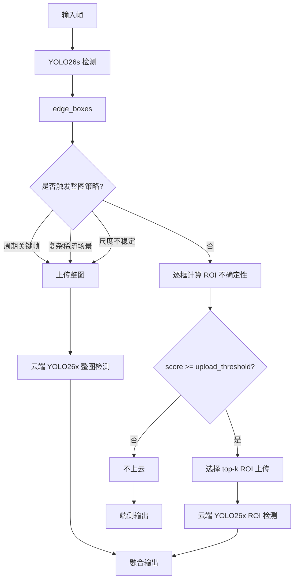

在代码中，规则 ROI 分数由 `detection_upload_score()` 计算，复杂场景由 `should_complexity_probe()` 计算，尺度稳定性由 `stability_probe_score()` 计算。

### 6.2 低置信检测如何定义

低置信检测针对的是“端侧已经检出目标，但置信度不够高”的情况。

代码中的信号：

```text
low_conf_signal = clamp((target_conf - conf) / target_conf, 0, 1)
target_conf = 0.65
```

解释：

- 如果 `conf = 0.65`，信号为 0，认为置信度足够。
- 如果 `conf = 0.325`，信号约为 0.5，开始被认为明显不稳定。
- 如果 `conf` 很低，信号接近 1。

在最终 ROI 不确定性分数中，低置信权重为 `0.35`：

```text
score += 0.35 * low_conf_signal
```

为什么低置信适合 ROI 上传？

因为端侧已经给出了目标位置，说明系统知道“哪里可能有东西”，但不确定类别或框质量。此时上传整图成本高，上传该目标周围 ROI 更经济。

### 6.3 小目标检测如何定义

小目标根据检测框面积占整张图面积的比例定义：

```text
area_ratio = box_area / image_area
small_object_signal = clamp((0.04 - area_ratio) / 0.04, 0, 1)
```

解释：

- 如果框面积占比接近 4% 或更大，小目标信号接近 0。
- 如果框面积很小，小目标信号接近 1。
- 当 `area_ratio <= 0.02` 时，小目标信号通常已经较强。

小目标在 ROI 分数中的权重为 `0.20`：

```text
score += 0.20 * small_object_signal
```

小目标为什么需要云端？

- 端侧模型分辨能力有限；
- 小目标更容易类别错；
- 小目标定位误差对 IoU 影响大；
- 云端大模型可能有更强的细粒度识别能力。

小目标 ROI 会被额外扩大上下文。当前 adaptive ROI 中：

```text
如果 area_ratio < 0.015，则 roi_gain 至少取 roi_small_gain
默认 roi_small_gain = 1.6
```

也就是说，小目标不是只裁原框，而是裁更大的周边区域，避免云端缺少上下文。

### 6.4 贴边目标检测如何定义

贴边目标有两种相关定义。

规则 ROI 中的边缘信号：

```text
如果 x1 <= 4%图宽，或 y1 <= 4%图高，
或 x2 >= 96%图宽，或 y2 >= 96%图高，
则 edge_area_signal = 1
否则 edge_area_signal = 0
```

adaptive ROI 中的边缘距离：

```text
edge_margin_ratio = 到最近图像边缘的距离 / min(image_h, image_w)
如果 edge_margin_ratio < 0.05，则认为贴边
```

贴边目标在 ROI 分数中的权重为 `0.15`：

```text
score += 0.15 * edge_area_signal
```

为什么贴边目标要上传 ROI？

- 目标可能被图像边界截断；
- 端侧框定位更不稳定；
- 边缘区域的上下文不足；
- 类别判断更容易依赖局部细节。

贴边 ROI 会扩大裁剪区域：

```text
如果 edge_margin_ratio < 0.05，则 roi_gain 至少取 roi_edge_gain
默认 roi_edge_gain = 1.45
```

如果目标已经非常大：

```text
如果 area_ratio > 0.20，则 roi_gain 会被压到较小值
默认 roi_large_gain = 1.15
```

这样避免大目标 ROI 裁剪过大，导致上传量接近整图。

### 6.5 时序不稳定如何定义

时序不稳定用于视频流。它比较当前框和上一帧同类别框的 IoU：

```text
如果没有同类别历史框:
    temporal_signal = 1
否则:
    best_iou = 当前框与历史同类框的最大 IoU
    temporal_signal = clamp((0.5 - best_iou) / 0.5, 0, 1)
```

解释：

- 如果同一个类别在连续帧中位置稳定，best_iou 高，时序信号低。
- 如果目标突然出现、位置变化大、类别不稳定，时序信号高。

时序不稳定在 ROI 分数中的权重为 `0.20`：

```text
score += 0.20 * temporal_instability
```

它适合 ROI 上传，因为目标位置已知，但连续帧表现不稳定，需要云端确认。

### 6.6 ROI 上传分数如何合成

当前规则 ROI 分数：

```text
score =
0.35 * low_conf
+ 0.20 * small_object
+ 0.15 * edge_area
+ 0.20 * temporal_instability
+ 0.10 * probe
```

其中 `probe` 当前基础实现中通常为 0。

如果：

```text
score >= upload_threshold
```

则该检测框成为 ROI 上传候选。

候选框会按 score 从高到低排序，然后只取前 `max_roi_per_image` 或 `max_roi_per_frame` 个：

```text
max_roi_per_image = 1  # 常见实验设置
```

这一步很重要，因为一张图可能有很多低置信小目标，如果全部上传，带宽和云端计算会失控。

举例：

```text
conf = 0.30 -> low_conf_signal ≈ 0.54
area_ratio = 0.01 -> small_object_signal = 0.75
贴边 -> edge_area_signal = 1
无历史稳定框 -> temporal_signal = 1

score = 0.35*0.54 + 0.20*0.75 + 0.15*1 + 0.20*1
      ≈ 0.689
```

如果 `upload_threshold=0.35`，这个目标会被选为 ROI 上传候选。

### 6.7 复杂稀疏场景如何定义

复杂稀疏场景针对的是“端侧可能漏检”的问题。此时不能只上传 ROI，因为漏掉的目标没有检测框，系统不知道该裁哪里。

复杂度使用 Canny edge density 作为轻量代理：

```text
image_complexity = Canny 边缘像素占比
```

检测覆盖率：

```text
coverage = sum(box_area_ratio) capped at 1.0
```

触发条件有三类：

```text
1. empty_complex_scene:
   没有任何 edge_boxes，且 complexity >= empty_complexity_threshold

2. complex_sparse_detections:
   complexity >= complexity_threshold，且检测框数量 <= max_detections

3. complex_low_coverage:
   complexity >= complexity_threshold，且 coverage <= coverage_threshold
```

如果任意一个条件成立：

```text
上传整图 keyframe
```

为什么是整图而不是 ROI？

因为复杂稀疏场景怀疑的是“漏检”，漏检目标没有框。如果只上传已有 ROI，无法发现未检测区域里的目标。

COCO full 规则 aggressive 的典型配置：

```text
complexity_threshold = 0.10
empty_complexity_threshold = 0.05
complexity_max_detections = 3
complexity_coverage_threshold = 0.06
```

这些阈值含义：

- 图像边缘密度超过 0.10，说明纹理或结构比较复杂；
- 没有检测框但边缘密度超过 0.05，说明“不是空白图”，可能漏检；
- 检测数不超过 3 或覆盖率很低，说明端侧对复杂图的解释不足。

### 6.8 周期关键帧如何定义

周期关键帧是最简单的整图上传策略：

```text
if frame_id % keyframe_interval == 0:
    上传整图
```

例如：

```text
keyframe_interval = 30
```

表示每 30 帧上传一次整图。

作用：

- 周期性校准端侧结果；
- 捕获端侧完全漏掉的新目标；
- 在视频里防止长期错误积累。

缺点：

- 不看画面是否困难；
- 上传成本固定；
- 可能上传很多简单帧。

因此，周期关键帧更适合作为 baseline 或安全兜底，不是最优策略。

### 6.9 尺度稳定性检查如何定义

尺度稳定性检查会额外跑一次较小输入尺寸的端侧检测，例如：

```text
primary: imgsz = 640
secondary: stability_imgsz = 384
```

然后比较两次检测结果：

```text
unmatched_ratio = 两次检测中未匹配框数量 / 总框数量
class_mismatch_ratio = 匹配框中类别不一致比例
score = min(1.0, 0.75 * unmatched_ratio + 0.25 * class_mismatch_ratio)
```

触发原因：

```text
unmatched_ratio >= 0.35 -> scale_unmatched_boxes
class_mismatch_ratio > 0 -> scale_class_disagreement
primary 有框 secondary 无框 -> scale_dropout
secondary 有框 primary 无框 -> scale_new_detections
```

如果：

```text
stability_score >= stability_threshold
```

则上传整图。

默认常见阈值：

```text
stability_threshold = 0.45
```

为什么尺度不稳定要上传整图？

如果同一张图在不同输入尺度下检测结果变化很大，说明端侧模型对该帧不稳定。此时问题可能不是某个框，而是整帧理解不可靠，所以更适合整图云端复核。

### 6.10 低置信 proposal 和 tile probe

这两个是实验性策略，不是当前默认主力。

低置信 proposal：

```text
从 YOLO26s 的低置信候选框中选择 conf 在 proposal_conf 和部署阈值之间的框。
这些框不作为端侧输出，但可以作为“疑似目标位置”上传给云端。
```

适用场景：

- 端侧有一点迹象，但不够可靠；
- 比 blind tile 更有方向。

tile probe：

```text
把图像划分为网格，计算每个 tile 的复杂度和检测覆盖率。
选择复杂但被端侧检测覆盖很少的 tile 上传。
```

适用场景：

- 目标位置完全未知；
- 怀疑某个区域漏检。

当前不推荐默认开启，因为它们在已有实验中没有稳定超过 v2 主策略，并且会增加带宽和云端计算。

### 6.11 ROI 与整图决策的直观总结

可以用一句话区分：

```text
已有框不可靠 -> ROI
没有框但怀疑漏检 / 整帧不稳定 -> 整图
```

更具体：

| 触发器 | 是否已有目标框 | 主要风险 | 上传类型 |
| --- | --- | --- | --- |
| 低置信检测 | 有 | 分类错、框不准 | ROI |
| 小目标检测 | 有 | 小目标识别和定位不稳 | ROI |
| 贴边目标 | 有 | 目标被截断、上下文不足 | ROI |
| 时序不稳定 | 有 | 目标状态突变 | ROI |
| 复杂稀疏场景 | 不一定有 | 漏检 | 整图 |
| 周期关键帧 | 不要求 | 长期漂移、漏检 | 整图 |
| 尺度稳定性差 | 不要求 | 整帧检测不稳定 | 整图 |
| proposal | 有低置信候选 | 被部署阈值过滤 | ROI/proposal |
| tile | 无明确框 | 区域漏检 | tile crop |

## 7. 延迟拆解

从接收视频到返回带框视频，可分为同步阻塞和异步两种口径。

### 7.1 同步阻塞

必须等云端结果回来再输出最终带框帧：

```text
T_blocking =
T_capture_decode
+ T_edge_yolo26s
+ T_feature_policy
+ T_jpeg_encode
+ T_upload_transfer
+ T_RTT
+ T_cloud_decode
+ T_cloud_yolo26x
+ T_response_decode
+ T_fusion_nms
+ T_draw_encode
```

当前成本表中的核心估计：

```text
T_est =
T_edge
+ payload_KB_per_image * 8 / uplink_Mbps
+ upload_ratio * RTT
+ upload_ratio * T_cloud
```

没有计入：

- 摄像头硬件采集；
- 浏览器/Gradio 调度；
- 最终视频编码写盘；
- 多线程队列等待；
- 服务端排队。

### 7.2 异步输出

真实部署更推荐异步：

```text
第一阶段: 先输出端侧 YOLO26s 检测框
第二阶段: 云端结果返回后修正对应帧或后续 track
```

异步口径：

```text
T_immediate ≈ T_capture_decode + T_edge_yolo26s + T_policy + T_draw
T_cloud_update ≈ T_jpeg_encode + T_upload_transfer + RTT + T_cloud_yolo26x + T_fusion
```

这样用户首先看到的是低延迟端侧结果，云端只做延迟校正。

### 7.3 当前默认点的延迟

默认：

```text
Learned v2 f0.60/r0.08
cloud_imgsz = 512
uploaded_image_ratio = 0.4248
avg payload per uploaded frame = 62.50 KB
payload per input image = 26.55 KB
edge latency = 18.61 ms
cloud latency per uploaded frame = 25.00 ms
```

不同网络下：

| 网络 | Edge | Upload | RTT 均摊 | Cloud 均摊 | Blocking E2E |
| --- | ---: | ---: | ---: | ---: | ---: |
| 2 Mbps / 100 ms RTT | 18.6 | 106.2 | 42.5 | 10.6 | 177.9 ms |
| 5 Mbps / 80 ms RTT | 18.6 | 42.5 | 34.0 | 10.6 | 105.7 ms |
| 10 Mbps / 50 ms RTT | 18.6 | 21.2 | 21.2 | 10.6 | 71.7 ms |
| 50 Mbps / 20 ms RTT | 18.6 | 4.2 | 8.5 | 10.6 | 42.0 ms |

单个上传帧在 10 Mbps / 50 ms RTT 下：

```text
T_uploaded_frame ≈ 18.6 + 62.5*8/10 + 50 + 25.0
                 ≈ 143.6 ms
```

不上云帧：

```text
T_non_uploaded_frame ≈ 18.6 ms
```

平均：

```text
Average ≈ 0.4248 * 143.6 + 0.5752 * 18.6
        ≈ 71.7 ms
```

所以平均延迟低于单个上传帧延迟，是因为不是每帧都上云。

## 8. 当前 COCO full v2 实验结果

### 8.1 实验设置

当前正式结果使用 COCO full：

```text
训练集: COCO train2017
验证集: COCO val2017
端侧模型: YOLO26s
云端模型: YOLO26x
端侧输入尺寸: imgsz=640
云端输入尺寸: cloud_imgsz=512
端侧部署置信度: conf=0.25
云端部署置信度: cloud_conf=0.25
mAP 统计候选阈值: metric_conf=0.001, metric_cloud_conf=0.001
JPEG quality: 80
```

这里要区分两个阈值：

| 阈值 | 作用 |
| --- | --- |
| `conf=0.25` | 部署输出阈值，低于它的端侧框不作为正常检测输出 |
| `metric_conf=0.001` | mAP 统计时保留更完整候选框，用于标准 AP 曲线计算 |

COCO full 数据集有 segmentation polygon 标签。远程实验已经修复了标签解析问题：polygon 标签会先转成外接 bbox，再参与目标检测评估。

### 8.2 策略名称怎么看

表中的 `Learned v2 f0.60/r0.08` 表示：

```text
Learned v2: 使用第二版学习型上传器
f0.60: frame threshold = 0.60
r0.08: ROI threshold = 0.08
cloud512: 云端 YOLO26x 推理输入尺寸为 512
```

更具体：

```text
frame threshold 控制整图上传
ROI threshold 控制 ROI 上传
```

如果 `f` 越低：

- 更多整图会上云；
- mAP 往往更高；
- 上传量、RTT 成本、云端计算更高。

如果 `f` 越高：

- 只有学习器非常确定整图有收益时才上传；
- 上传更少；
- 延迟更低；
- 可能错过一些需要云端复核的困难样本。

如果 `r` 越低：

- 更多 ROI 会上传；
- 对单个目标的纠错机会更多；
- 上传任务数可能增加。

如果 `r` 越高：

- ROI 上传更保守；
- 带宽和云端计算更低；
- 可能放过一些低置信目标。

当前 COCO full v2 结果里，ROI 上传很少，收益主要来自学习器选择性整图上传。

### 8.3 指标含义

| 指标 | 含义 | 越大/越小 |
| --- | --- | --- |
| `Precision` | 预测为目标的框中有多少是真的 | 越大越好，反映误检少 |
| `Recall` | GT 目标中有多少被检出 | 越大越好，反映漏检少 |
| `mAP50` | IoU=0.50 时的平均 AP | 越大越好，定位要求较宽松 |
| `mAP50-95` | IoU=0.50 到 0.95 的平均 AP | 越大越好，定位和排序要求更严格 |
| `上传图像比` | 至少触发一次上传的图像数 / 总图像数 | 越小成本越低 |
| `KB/image` | 总上传 KB / 总图像数 | 越小带宽越省 |
| `GFLOPs/image` | 端侧 + 均摊云端计算量 | 越小计算成本越低 |
| `E2E@10Mbps` | 10Mbps、50ms RTT 下估计同步阻塞延迟 | 越小越快 |

`mAP50-95` 是最重要的综合精度指标，因为它同时考虑分类、置信度排序和不同 IoU 阈值下的定位质量。

### 8.4 结果总表

| 策略 | Precision | Recall | mAP50 | mAP50-95 | 上传图像比 | KB/image | GFLOPs/image | E2E@10Mbps |
| --- | ---: | ---: | ---: | ---: | ---: | ---: | ---: | ---: |
| Edge-only YOLO26s | 0.6913 | 0.5781 | 0.6346 | 0.4733 | 0 | 0 | 22.8 | 18.2 ms |
| Cloud-only YOLO26x | 0.7383 | 0.6700 | 0.7327 | 0.5656 | 1.0 | 全图 | 209.5 | 取决于网络 |
| Rule aggressive | 0.7318 | 0.5832 | 0.6817 | 0.5486 | 0.6406 | 22.94 | 168.1 | 84.1 ms |
| Learned v1 f0.60/r0.08 | 0.7622 | 0.6108 | 0.7071 | 0.5744 | 0.6686 | 34.77 | 112.5 | 97.0 ms |
| Learned v2 f0.50/r0.05 | 0.7835 | 0.6202 | 0.7251 | 0.5918 | 0.5656 | 34.90 | 98.7 | 85.4 ms |
| Learned v2 f0.60/r0.08 | 0.7758 | 0.6092 | 0.7163 | 0.5829 | 0.4248 | 26.55 | 79.8 | 71.7 ms |
| Learned v2 f0.70/r0.10 | 0.7671 | 0.5919 | 0.7032 | 0.5704 | 0.2442 | 15.87 | 55.6 | 49.9 ms |
| Learned v2 f0.80/r0.10 | 0.7519 | 0.5748 | 0.6861 | 0.5518 | 0.0920 | 6.28 | 35.2 | 32.1 ms |

### 8.5 如何读这张表

Edge-only 是最低成本基线：

```text
mAP50-95 = 0.4733
上传 = 0
E2E@10Mbps = 18.2 ms
```

它快，但精度有限。

Cloud-only 是单模型云端基线：

```text
mAP50-95 = 0.5656
GFLOPs/image = 209.5
```

它比 edge-only 准，但每张图都需要云端强模型，网络和计算成本高。

Rule aggressive：

```text
mAP50-95 = 0.5486
上传图像比 = 0.6406
GFLOPs/image = 168.1
```

规则策略能提升 edge-only，但成本较高，且不如学习器 v2。

Learned v2 f0.50/r0.05：

```text
mAP50-95 = 0.5918
上传图像比 = 0.5656
E2E@10Mbps = 85.4 ms
```

这是当前精度最高点。它适合论文展示、离线分析或网络条件较好的场景。

Learned v2 f0.60/r0.08：

```text
mAP50-95 = 0.5829
上传图像比 = 0.4248
E2E@10Mbps = 71.7 ms
```

这是默认推荐平衡点。相比 f0.50/r0.05，它牺牲约 `0.0089` 的 mAP50-95，但上传图像比从 `0.5656` 降到 `0.4248`，平均延迟也从 `85.4 ms` 降到 `71.7 ms`。

Learned v2 f0.70/r0.10：

```text
mAP50-95 = 0.5704
上传图像比 = 0.2442
E2E@10Mbps = 49.9 ms
```

这是弱网或低延迟优先点。它仍高于 Cloud-only 的 `0.5656`，但只上传约 24.42% 图像。

Learned v2 f0.80/r0.10：

```text
mAP50-95 = 0.5518
上传图像比 = 0.0920
E2E@10Mbps = 32.1 ms
```

这是极低带宽点。精度低于 Cloud-only，但比 edge-only 有明显提升，上传量很低。

### 8.6 为什么默认选择 f0.60/r0.08

默认点不是最高精度点，而是工程平衡点。

对比：

| 工作点 | mAP50-95 | 上传图像比 | KB/image | E2E@10Mbps |
| --- | ---: | ---: | ---: | ---: |
| v2 f0.50/r0.05 | 0.5918 | 0.5656 | 34.90 | 85.4 ms |
| v2 f0.60/r0.08 | 0.5829 | 0.4248 | 26.55 | 71.7 ms |

差异：

```text
mAP50-95 下降: 0.5918 - 0.5829 = 0.0089
上传图像比下降: 0.5656 - 0.4248 = 0.1408
KB/image 下降: 34.90 - 26.55 = 8.35 KB/image
延迟下降: 85.4 - 71.7 = 13.7 ms
```

所以默认点的逻辑是：

```text
保留大部分精度收益，同时明显降低带宽和延迟。
```

如果场景是论文精度优先，可以报告 f0.50/r0.05；如果场景是野外弱网，可以使用 f0.70/r0.10。

### 8.7 每个策略适合什么场景

| 场景 | 推荐策略 | 原因 |
| --- | --- | --- |
| 无网络或极端实时 | Edge-only | 端侧独立运行，延迟最低 |
| 云端资源充足但想简单 | Cloud-only | 实现简单，但带宽和云端成本高 |
| 没有训练数据，冷启动 | Rule aggressive 或较保守规则 | 不需要训练，可解释 |
| 综合部署默认 | Learned v2 f0.60/r0.08 | 精度、带宽、延迟平衡 |
| 论文精度优先 | Learned v2 f0.50/r0.05 | 当前 mAP50-95 最高 |
| 弱网野外部署 | Learned v2 f0.70/r0.10 | 上传少，延迟低 |
| 极低带宽/电量敏感 | Learned v2 f0.80/r0.10 | 只上传很少高价值帧 |

### 8.8 结果边界和注意事项

这些结果说明当前方法在 COCO full 上有效，但还需要注意：

- 学习器在 COCO 上训练，换到 CCT、VisDrone、BDD100K 后应该重训或校准；
- 当前 COCO full 中收益主要来自整图上传，ROI 分支还有继续优化空间；
- Gradio 的实时延迟包含浏览器和 UI 调度，不适合作为严格延迟指标；
- `full_frame_fusion_upper` 是 oracle 上限，不是部署结果；
- 未来最好补充真实视频流上的端到端统计，包括采集、编码、队列等待和返回绘制。

推荐：

```text
精度优先: v2 f0.50/r0.05
默认平衡: v2 f0.60/r0.08
弱网优先: v2 f0.70/r0.10
极低带宽: v2 f0.80/r0.10
```

## 9. 使用方式

启动云端：

```bash
conda activate yolo26
cd /home/111_wcy/work/yolo26/ultralytics-main
python examples/YOLO26-Edge-Cloud/cloud_server.py \
  --model yolo26x.pt \
  --host 0.0.0.0 \
  --port 8765 \
  --device 0
```

启动 Gradio：

```bash
python examples/YOLO26-Edge-Cloud/gradio_demo.py \
  --edge-model yolo26s.pt \
  --cloud-url http://127.0.0.1:8765/infer \
  --policy-path runs/edge_cloud/learned_policy_coco_full_v2_20260424_1225/learned_upload_policy.json \
  --learned-frame-threshold 0.60 \
  --learned-roi-threshold 0.08 \
  --cloud-imgsz 512 \
  --inbrowser
```

如果云端在远程，本地先开 SSH 隧道：

```bash
ssh -L 8765:127.0.0.1:8765 -p 10022 111_wcy@10.193.114.121
```

然后本地仍然访问：

```text
http://127.0.0.1:8765/infer
```

## 10. 后续优化方向

当前结果说明 v2 学习器有效，但仍有优化空间：

- 增加网络状态输入：`uplink_mbps`、`RTT`、队列长度、丢包率；
- 增强 temporal memory：减少视频连续帧重复整图上传；
- 重新训练 CCT/VisDrone/BDD100K 等目标域学习器；
- 改进整图融合策略，而不是整图上传后直接偏向云端结果；
- 增加同口径 Cloud-only deployment baseline；
- 将 JSON + base64 换成 multipart/gRPC/QUIC，降低协议开销；
- 在真实视频上统计端到端延迟，包括采集、绘制、编码和队列等待。

## 11. 关键问题逐条说明和单图例子

这一节专门回答实现时最容易混淆的概念：什么是图像级特征、ROI 到底是不是 `edge_boxes`、端云结果如何融合、学习器的收益和代价怎么算，以及为什么有时协同结果的 `mAP50-95` 会高于 Cloud-only。

### 11.1 图像级特征提取是什么意思

这里的“图像级特征”不是再跑一个大模型，也不是把整张图上传到云端。它是在端侧已经拿到一帧图像和 YOLO26s 检测结果之后，快速计算出的整帧统计量。

关系可以这样理解：

```text
视频流/图片文件
  -> 解码得到当前帧 frame
  -> YOLO26s 在 frame 上检测，得到 edge_boxes
  -> 根据 frame + edge_boxes 计算图像级特征 frame_features
  -> 学习器/规则策略用 frame_features 判断是否整图上云
```

`frame` 是当前输入图像本身，例如一张 `640x480` 的 BGR 图片。`edge_boxes` 是端侧 YOLO26s 在这张图上检测出的框。图像级特征就是“这张图整体难不难、端侧结果可不可信”的数值化描述。

当前实现里，图像级特征来自 `examples/YOLO26-Edge-Cloud/learned_uploader.py` 的 `image_context()` 和 `frame_features()`，主要包括：

| 特征 | 含义 | 来源 |
| --- | --- | --- |
| `image_complexity` | 图像纹理复杂度，用 Canny 边缘密度近似 | 原始 frame |
| `det_count` | 端侧检测数量，按 20 个目标归一化 | `edge_boxes` |
| `coverage` | 所有端侧框面积占整图比例的近似和 | `edge_boxes` |
| `max_conf`/`mean_conf`/`min_conf` | 端侧检测置信度统计 | `edge_boxes` |
| `conf_std` | 端侧框置信度波动 | `edge_boxes` |
| `empty` | 端侧是否没有检出任何目标 | `edge_boxes` |
| `sparse` | 端侧检测是否稀疏，当前定义为框数不超过 2 | `edge_boxes` |
| `low_coverage` | 检测覆盖面积是否很低，当前阈值为 `coverage <= 0.04` | `edge_boxes` |
| `mean_area`/`max_area` | 端侧框平均面积和最大面积占比 | `edge_boxes` |
| `edge_box_ratio` | 有多少端侧框贴近图像边界 | `edge_boxes` |
| `low_conf_ratio` | 有多少端侧框置信度低于 0.45 | `edge_boxes` |
| `small_box_ratio` | 有多少端侧框面积小于整图 1.5% | `edge_boxes` |

所以，图像级特征可以看成一个整帧向量：

```text
frame_features = [
  图像复杂度,
  检测数量,
  检测覆盖率,
  置信度统计,
  是否空检/稀疏,
  小目标比例,
  贴边目标比例
]
```

它和“帧图片”的关系是：帧图片是原始输入，图像级特征是从这张帧图片和端侧检测结果中提取出来的轻量统计特征。它通常只参与端侧决策，不需要上传。

### 11.2 ROI 是怎么定义的，ROI 是不是 `edge_boxes`

ROI 不是简单等于 `edge_boxes`。更准确地说：

```text
edge_boxes 是端侧检测框集合；
ROI 是根据某一个 edge_box 或低置信候选框扩展出来的裁剪区域；
上传的是 ROI 裁剪后的图像块，而不是只上传框坐标。
```

当前 ROI 生成流程如下：

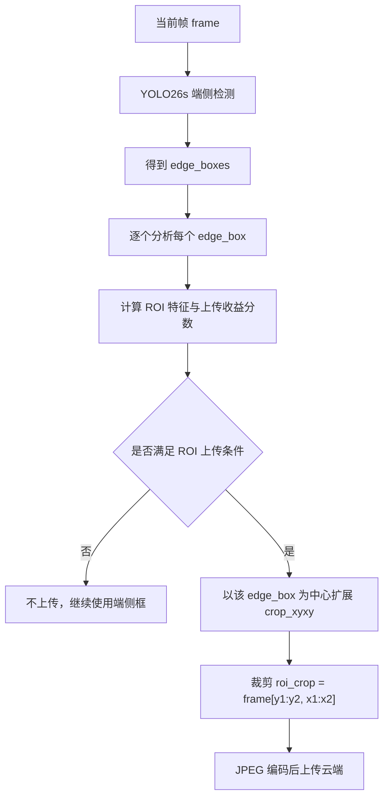

一个端侧框是：

```text
edge_box = [x1, y1, x2, y2, conf, cls]
```

ROI 裁剪框是：

```text
crop_xyxy = expand_xyxy(edge_box.xyxy, image_shape, roi_gain)
```

其中 `roi_gain` 是扩展倍率。当前自适应扩展逻辑在 `upload_strategies.py` 的 `adaptive_roi_gain()` 中：

| 情况 | 当前判断 | 扩展倾向 |
| --- | --- | --- |
| 小目标 | `area_ratio < 0.015` | 扩得更大，默认可到 `small_gain` |
| 贴边目标 | `edge_margin < 0.05` | 扩得更大，避免裁掉上下文 |
| 大目标 | `area_ratio > 0.20` | 扩得更小，避免上传几乎整图 |
| 普通目标 | 不满足特殊条件 | 使用基础扩展倍率 |

因此 ROI 是“围绕端侧目标或候选目标的图像区域”，不是框坐标本身。框坐标只是决定裁剪位置的依据。

### 11.3 为什么云端检测整图没有框，检测 ROI 反而有框

这不是矛盾，在固定输入尺寸检测器里非常常见。原因主要有四个：

1. 整图缩放会让小目标变小  
   例如原图中一个手套只有 `50x40` 像素。整图送入 YOLO26x 时，如果图像被 letterbox 到 `512x512`，这个目标在网络输入里的有效像素仍然很小，特征容易被背景淹没。把 ROI 裁剪出来后再 resize 到 `512x512`，同一个手套可能占据更大的网络输入区域，检测更容易。

2. ROI 减少了背景干扰  
   整图里有树、草地、人物、阴影等复杂背景。ROI 裁剪后只保留目标附近局部区域，分类头和回归头面对的干扰少。

3. NMS 和置信度排序会改变  
   整图检测时，不同目标之间会竞争候选框，低分小目标可能被过滤。ROI 检测时候选框少，局部目标的置信度可能上升。

4. 上下文尺度不同  
   有些目标需要局部纹理才能识别，ROI 放大后更清楚。但也存在反例：有些目标需要全局上下文，裁剪太小反而会误检。因此 ROI 必须有收益判断，不能所有框都上传。

可以用一个具体例子说明。脚本 `runs/edge_cloud/example_flow/generate_example_flow.py` 在 COCO val 中选择了：

```text
图片: F:\IDE\datasets\coco\images\val2017\000000000872.jpg
端侧 YOLO26s 检测框数: 4
云端 YOLO26x 整图 cloud_imgsz=512 检测框数: 3
候选 ROI: [351, 145, 454, 215]
ROI JPEG 估计大小: 2.06 KB
云端检测 ROI 后框数: 2
ROI 检测框是否能匹配整图云端框: false
```

对应可视化文件在：

| 文件 | 说明 |
| --- | --- |
| `runs/edge_cloud/example_flow/01_original.jpg` | 原始图片 |
| `runs/edge_cloud/example_flow/02_edge_yolo26s.jpg` | YOLO26s 端侧检测结果 |
| `runs/edge_cloud/example_flow/03_frame_decision.jpg` | 整图上传分支的学习器分数 |
| `runs/edge_cloud/example_flow/04_cloud_yolo26x_full512.jpg` | YOLO26x 对整图 `512` 输入的检测结果 |
| `runs/edge_cloud/example_flow/06_roi_candidate_on_image.jpg` | ROI 候选区域在原图中的位置 |
| `runs/edge_cloud/example_flow/07_roi_crop.jpg` | 实际裁剪出来并准备上传的 ROI 图像块 |
| `runs/edge_cloud/example_flow/08_cloud_on_roi_crop.jpg` | 云端模型在 ROI crop 上的检测结果 |
| `runs/edge_cloud/example_flow/09_roi_fused_back.jpg` | ROI 检测结果映射回原图后的效果 |

文档渲染支持图片时，可以直接查看下面这些图：


注意：这个例子主要用于解释“为什么 ROI 裁剪后可能检测出来”。默认 `f0.60/r0.08` 部署下，这个 ROI 的学习器结果是：

```text
roi_probability = 0.0401
roi_expected_gain = 0.0000
roi_decision = -0.0004
roi_threshold = 0.08
```

因此默认策略不会上传这个 ROI。它说明“ROI 机制有可能发现整图没发现的局部目标”，但学习器认为这次收益不够稳定，不值得付出上传和云端计算成本。这正是学习型上传器和普通 ROI+云复核的区别：不是只要 ROI 能检出东西就上传，而是要判断它是否能提高最终指标。

### 11.4 `edge_boxes` 和 `cloud_boxes` 如何融合

先定义三个集合：

```text
edge_boxes: 端侧 YOLO26s 在当前帧上的检测结果
cloud_boxes: 云端 YOLO26x 对整图或 ROI 的检测结果
final_boxes: 最终返回给用户的检测结果
```

不同上传类型的融合方式不同。

**1. 没有上传时**

```text
final_boxes = edge_boxes
```

这时系统完全复用端侧输出，延迟最低。

**2. ROI 上传时**

ROI 上传不是简单把 `edge_boxes` 和 `cloud_boxes` 拼起来。当前部署逻辑是：

```text
final_boxes 初始为 edge_boxes
云端检测 roi_crop，得到 roi_cloud_boxes
把 roi_cloud_boxes 加上 crop 左上角偏移，映射回原图坐标
只用这些云端结果修正对应 ROI 附近的端侧框
最后做 class-aware NMS
```

实现对应 `evaluate_edge_cloud.py` 的 `apply_roi_cloud()`：

```text
如果 cloud_box 与目标 edge_box 的 IoU >= iou_match:
    用 cloud_box 替换该 edge_box
否则:
    如果该 edge_box 置信度低于 veto_edge_conf:
        删除该 edge_box
    如果该 edge_box 置信度足够高:
        保留该 edge_box

对 ROI 中没有匹配到 edge_box 的 cloud_box:
    如果 cloud_conf >= roi_extra_cloud_conf:
        作为云端新增框加入 final_boxes

最后:
    对 final_boxes 做类别感知 NMS
```

所以 ROI 上传后：

- 没上传的端侧框会继续保留；
- 上传 ROI 对应的端侧框可能被云端框替换；
- 如果云端没有确认且端侧框本身置信度很低，该框可能被删除；
- ROI 内额外云端框如果置信度足够高，可以补充进最终结果；
- 最终不是无脑拼接，而是匹配、替换、补充、NMS。

**3. 整图上传时**

当前评估主路径里，如果学习器决定整图上传：

```text
final_boxes = cloud_boxes
```

这样做的原因是：整图上云代表学习器认为“这一帧整体困难，云端模型更可信”，所以直接采用云端整图结果，逻辑简单、可解释、延迟也更稳定。

另外代码里也实现了 `full_frame_fusion_boxes()`，它是更细的整图融合函数：

```text
edge_boxes 与 cloud_boxes 按 IoU 匹配
同类匹配时保留置信度更高者
类别冲突时优先云端纠错，但要求云端置信度过阈值
未匹配端侧框如果过 edge_conf_threshold，保留
未匹配云端框如果过 cloud_conf_threshold，加入
最后 class-aware NMS
```

但是当前正式 COCO full v2 结果主要采用“整图上传后用云端结果”的主路径。后续如果要进一步提高稳定性，可以把整图上传也改成学习型融合，而不是简单偏向云端。

### 11.5 收益-代价分数 `score = p_gain * expected_gain - lambda * estimated_payload_KB / 100`

这个公式的目标是把“精度收益”和“通信代价”放到同一个决策分数里。

```text
score = p_gain * expected_gain - lambda * estimated_payload_KB / 100
```

各项含义如下：

| 符号 | 当前代码变量 | 含义 |
| --- | --- | --- |
| `p_gain` | `probability` | 学习器判断“上传后会带来正收益”的概率 |
| `expected_gain` | `expected_gain` | 学习器预测的归一化收益大小 |
| `lambda` | `learned_cost_weight` / `cost_weight` | 资源代价权重，越大越保守 |
| `estimated_payload_KB` | `full_frame_kb` 或 `estimated_kb` | 当前整图或 ROI 上传的 JPEG 估计大小 |
| `/100` | 固定尺度因子 | 让 KB 量级和收益量级更接近 |

决策逻辑不是只看概率，也不是只看收益：

```text
如果 p_gain 很高，但 expected_gain 很小:
    说明上传大概率有一点点改善，但改善幅度可能不值得

如果 expected_gain 很高，但 p_gain 很低:
    说明一旦成功收益大，但不确定性太强

如果图片很大，estimated_payload_KB 很高:
    同样的精度收益会被带宽代价抵消
```

当前上线判断一般是：

```text
probability >= threshold
并且
score > 0
```

也就是说，上传必须同时满足“有足够把握”和“收益扣除代价后仍为正”。

### 11.6 整图上传分数为什么这样算

整图分支公式是：

```text
frame_score = p_frame * max(0, gain_frame)
              - cost_weight * full_frame_kb / 100
```

其中：

| 变量 | 含义 | 如何得到 |
| --- | --- | --- |
| `p_frame` | 当前帧整图上传会提升结果的概率 | 学习器 frame logistic head 输出 |
| `gain_frame` | 当前帧整图上传的预期收益大小 | 学习器 frame value head 输出 |
| `max(0, gain_frame)` | 不允许负收益作为正向奖励 | 推理时裁剪 |
| `cost_weight` | 通信成本权重，当前常用 `0.02` | 部署超参数 |
| `full_frame_kb` | 当前帧按 JPEG quality=80 编码后的 KB | 端侧实时编码估计 |
| `/100` | 尺度因子 | 固定归一化 |

训练时，`p_frame` 和 `gain_frame` 来自同一批样本，但训练目标不同。

对每张训练图：

```text
edge_result = YOLO26s(image)
cloud_full_result = YOLO26x(image)
edge_utility = utility(edge_result, labels)
cloud_utility = utility(cloud_full_result, labels)
frame_gain_raw = cloud_utility - edge_utility
frame_gain = frame_gain_raw / max(1, GT 数量)
frame_label = 1 if frame_gain > utility_margin else 0
```

然后：

- `frame_model` 学 `frame_features -> frame_label`，输出 `p_frame`；
- `frame_value_model` 学 `frame_features -> frame_gain`，输出 `gain_frame`。

`utility()` 当前不是 mAP，而是一个训练用的目标级代理函数：

```text
utility = TP - fp_penalty * FP
```

其中 TP 要求预测框和 GT 同类别，且 IoU >= 0.5。FP 会按 `fp_penalty` 扣分，当前默认 `0.25`。这样训练器不仅奖励检出目标，也惩罚误检。

训练时如何知道“不值得上传”？答案是看 `frame_gain`：

| 情况 | `frame_gain` 可能结果 | 学习器学到的倾向 |
| --- | --- | --- |
| 端侧已经检测正确，云端没有新增有效目标 | 接近 0 | 不值得上传 |
| 云端比端侧多检出真实目标 | 正数 | 值得上传 |
| 云端新增很多误检 | 可能为负 | 不值得上传 |
| 云端漏掉端侧已检出的目标 | 可能为负 | 不值得上传 |
| 云端只带来很小收益，但图片很大 | 小正数 | 可能被成本项抵消 |

所以训练不是主观规定“哪些图不值得上传”，而是用 GT 标签计算上传前后的目标级效用差。

### 11.7 ROI 分数如何计算

ROI 分支和整图分支形式相同，只是样本粒度从“整张图”变成“某个端侧框附近的局部区域”。

推理时对每个候选 ROI：

```text
roi_score = p_roi * max(0, gain_roi)
            - cost_weight * estimated_roi_kb / 100
```

其中：

| 变量 | 含义 | 如何得到 |
| --- | --- | --- |
| `p_roi` | 上传该 ROI 后能提升最终结果的概率 | 学习器 ROI logistic head 输出 |
| `gain_roi` | 上传该 ROI 的预期收益大小 | 学习器 ROI value head 输出 |
| `estimated_roi_kb` | ROI crop 的估计上传大小 | `full_frame_kb * crop_area / image_area`，下限 1 KB |
| `cost_weight` | 通信成本权重 | 部署超参数 |

训练时对候选 ROI：

```text
edge_result = YOLO26s(image)
edge_utility = utility(edge_result, labels)

roi_crop = crop(image, expanded_edge_box)
roi_cloud_result = YOLO26x(roi_crop)
shifted_cloud_boxes = shift_boxes(roi_cloud_result, crop_xyxy 左上角)
roi_fused_result = apply_roi_cloud(edge_result, target_edge_index, shifted_cloud_boxes)

roi_gain_raw = utility(roi_fused_result, labels) - edge_utility
roi_gain = roi_gain_raw / max(1, GT 数量)
roi_label = 1 if roi_gain > utility_margin else 0
```

然后：

- `roi_model` 学 `roi_features -> roi_label`，输出 `p_roi`；
- `roi_value_model` 学 `roi_features -> roi_gain`，输出 `gain_roi`。

ROI 特征包括该框自身和整帧上下文：

| 特征 | 含义 |
| --- | --- |
| `conf` | 端侧框置信度 |
| `inv_conf` | `1 - conf`，置信度越低越可能需要复核 |
| `relative_conf` | 当前框置信度相对整图平均置信度的差 |
| `area`/`log_area` | 框面积占比及其对数 |
| `aspect_log` | 宽高比对数 |
| `edge_margin` | 距离图像边界的归一化距离 |
| `is_small` | 是否小目标 |
| `is_edge` | 是否贴边目标 |
| `center_x`/`center_y` | 框中心位置 |
| `coverage_share` | 该框面积在检测覆盖面积中的占比 |
| `image_complexity` | 整图复杂度 |
| `det_count` | 整图检测数量 |
| `coverage` | 整图检测覆盖率 |

这解释了为什么 ROI 学习器不是单纯“低置信就上传”。低置信只是特征之一，还要结合目标大小、位置、图像复杂度、上传大小和历史训练收益。

### 11.8 为什么 `frame_threshold=0.60`、`roi_threshold=0.08`

这两个阈值不是训练阶段自动固定出来的，而是训练好学习器之后，在 COCO val2017 上做部署阈值扫描得到的工程折中点。

当前结果里：

| 策略 | mAP50-95 | 上传图像比 | KB/image | E2E@10Mbps |
| --- | ---: | ---: | ---: | ---: |
| `Learned v2 f0.50/r0.05` | 0.5918 | 0.5656 | 34.90 | 85.4 ms |
| `Learned v2 f0.60/r0.08` | 0.5829 | 0.4248 | 26.55 | 71.7 ms |
| `Learned v2 f0.70/r0.10` | 0.5704 | 0.2442 | 15.87 | 49.9 ms |
| `Learned v2 f0.80/r0.10` | 0.5518 | 0.0920 | 6.28 | 32.1 ms |

`f0.50/r0.05` 精度最高，但上传和延迟更高。`f0.70/r0.10` 更快，但精度下降。`f0.60/r0.08` 的定位是默认平衡点：

```text
相比 f0.50/r0.05:
mAP50-95 下降 0.0089
上传图像比下降 0.1408
KB/image 下降 8.35
E2E@10Mbps 下降 13.7 ms
```

为什么 ROI 阈值看起来比 frame 阈值低很多？因为两个分支的概率分布不是同一个标尺：

- frame 分支每张图一个样本，正样本比例相对高；
- ROI 分支每个候选框一个样本，正样本更稀疏；
- ROI 的收益通常只影响局部目标，`gain_roi` 数值也更小；
- 因此 ROI 分支的 probability/score 本来就会低一些，不能和 frame threshold 直接比较。

### 11.9 `cloud_imgsz=512` 和 `cloud_imgsz=640`

直觉上 `640` 可能更准，尤其对小目标更友好。但在端云协同系统里，不能只看单次云端精度，还要看：

```text
云端计算量
网络延迟
上传比例
融合后 AP
置信度排序和 NMS 变化
```

之前在 COCO128 原型实验里做过对比，结果是：

| 云端设置 | mAP50-95 | GFLOPs/image | E2E@10Mbps |
| --- | ---: | ---: | ---: |
| learned cloud416 | 0.6443 | 60.9 | 100.4 ms |
| learned cloud512 | 0.6514 | 80.5 | 104.2 ms |
| learned cloud640 | 0.6478 | 112.9 | 105.3 ms |
| adaptive 416/512 | 0.6555 | 71.6 | 101.5 ms |

这个结果说明：`640` 不一定在融合系统里更高。原因可能是：

- 云端单模型更大输入不一定让 AP 曲线整体更好；
- 置信度排序、NMS 和融合策略会改变最终 AP；
- ROI/整图混合后，局部纠错收益不只由云端输入尺寸决定；
- `640` 的云端计算成本明显更高。

从计算量看，YOLO26x `640` 单次约 `209.5 GFLOPs`。如果按输入面积近似缩放：

```text
cloud512 计算量 ≈ 209.5 * (512 / 640)^2
              ≈ 134.1 GFLOPs / upload
```

所以默认用 `cloud_imgsz=512` 是因为它在当前实验中提供了更好的精度-计算折中。需要实事求是地说：COCO full v2 当前正式表格主要是 `cloud512`，还没有完整重跑 `cloud640` 的 v2 全量扫描。若论文需要证明 `512` 最优，后续应补一组同口径 COCO full `cloud640` 扫描。

### 11.10 学习器 v2 是带参数的模型吗，为什么保存成 JSON

学习器 v2 是有参数的，但它不是神经网络大模型，而是轻量的线性/逻辑回归决策器。

它包含四个头：

```text
frame_model:        整图上传概率头，输出 p_frame
frame_value_model:  整图收益回归头，输出 gain_frame
roi_model:          ROI 上传概率头，输出 p_roi
roi_value_model:    ROI 收益回归头，输出 gain_roi
```

每个头的参数包括：

```text
weights
bias
mean
std
```

推理时计算方式是：

```text
x_norm = (features - mean) / std
linear = x_norm @ weights + bias

如果是概率头:
    probability = sigmoid(linear)

如果是收益头:
    expected_gain = linear
```

这些参数完全可以保存在 JSON 里，所以当前 `learned_upload_policy.json` 不是普通配置文件，而是轻量模型权重文件。这样做有几个工程好处：

- 端侧加载快；
- 不依赖 PyTorch 训练图；
- 便于查看每个 head 的特征顺序和参数；
- 适合嵌入 C++、Python、边缘脚本或服务端。

当前推理时不会继续训练。`调阈值 / 重训学习器 / 切换策略` 属于离线反馈闭环：

```text
在线推理:
  读取 policy JSON -> 提取特征 -> 算分 -> 决定上传

离线优化:
  收集日志和验证集结果 -> 调阈值或重训 -> 生成新的 policy JSON -> 下次部署加载
```

因此，不是边推理边训练。训练完成后，部署端只做非常轻的向量计算。

### 11.11 学习器 v2 的单图完整流程

以 `000000000872.jpg` 为例，当前脚本输出的关键数值为：

```text
edge_boxes = 4
cloud_full_boxes = 3
frame_probability = 0.5738
frame_expected_gain = 0.0749
frame_decision = 0.0203
full_frame_kb = 113.39
roi_probability = 0.0401
roi_expected_gain = 0.0000
roi_decision = -0.0004
roi_estimated_kb = 2.06
```

默认阈值下：

```text
frame_probability = 0.5738 < frame_threshold 0.60
所以不整图上传

roi_probability = 0.0401 < roi_threshold 0.08
roi_decision < 0
所以不 ROI 上传

最终输出 = edge_boxes
```

完整流程如下：

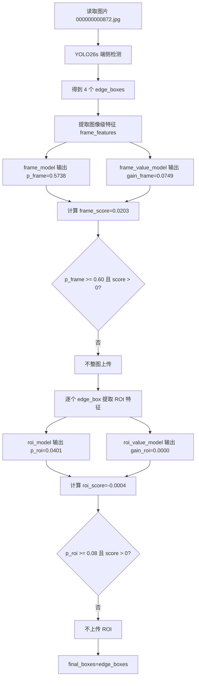

如果阈值放宽，或者在另一张图上满足条件，ROI 上传分支会继续：

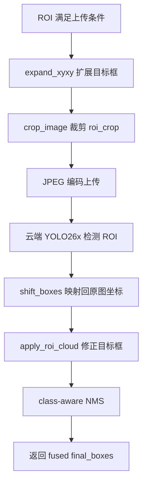

### 11.12 训练时 `frame_gain` 和 `ROI gain` 如何计算

训练阶段需要 GT 标签，因为要知道上传前后是不是真的变好。

**frame_gain 计算：**

```text
edge_boxes = YOLO26s(image)
cloud_boxes = YOLO26x(image)

edge_utility = TP(edge_boxes) - fp_penalty * FP(edge_boxes)
cloud_utility = TP(cloud_boxes) - fp_penalty * FP(cloud_boxes)

frame_gain_raw = cloud_utility - edge_utility
frame_gain = frame_gain_raw / max(1, GT_count)
frame_label = 1 if frame_gain > utility_margin else 0
```

**ROI gain 计算：**

```text
edge_boxes = YOLO26s(image)
edge_utility = TP(edge_boxes) - fp_penalty * FP(edge_boxes)

对候选 edge_box:
    roi_crop = crop(expand(edge_box))
    roi_cloud_boxes = YOLO26x(roi_crop)
    shifted_cloud_boxes = shift_boxes(roi_cloud_boxes)
    fused_boxes = apply_roi_cloud(edge_boxes, target_edge_index, shifted_cloud_boxes)

roi_utility = TP(fused_boxes) - fp_penalty * FP(fused_boxes)
roi_gain_raw = roi_utility - edge_utility
roi_gain = roi_gain_raw / max(1, GT_count)
roi_label = 1 if roi_gain > utility_margin else 0
```

`frame_label` 和 `roi_label` 用于训练概率头，`frame_gain` 和 `roi_gain` 用于训练收益回归头。

这就是学习器 v2 的理论依据：上传决策不是凭经验写死，而是用“上传前后的目标级效用差”作为监督信号，让模型学习哪些场景值得付出通信和云端计算代价。

### 11.13 为什么 `mAP50` 低于 Cloud-only，但 `mAP50-95` 高于 Cloud-only

当前表中：

```text
Cloud-only YOLO26x:
  mAP50 = 0.7327
  mAP50-95 = 0.5656

Learned v2 f0.50/r0.05:
  mAP50 = 0.7251
  mAP50-95 = 0.5918
```

这说明协同系统在宽松 IoU=0.50 下的召回/排序略低于 Cloud-only，但在更严格的 IoU 范围平均指标上更好。

原因是 `mAP50` 和 `mAP50-95` 衡量重点不同：

| 指标 | 更关注什么 |
| --- | --- |
| `mAP50` | 只要框和 GT 有 0.5 IoU 就算定位合格，更偏宽松召回 |
| `mAP50-95` | 从 IoU 0.50 到 0.95 多阈值平均，更关注定位精度、排序稳定性和误检控制 |

举一个简化例子：

```text
GT: 1 个 person

Cloud-only:
  检出 person，IoU=0.56，conf=0.90
  在 mAP50 下算 TP
  但在 IoU=0.75、0.90 下不算 TP

Edge-cloud fused:
  端侧框更贴近 person，IoU=0.78，conf=0.70
  云端没有覆盖掉这个好框
  在 mAP50、mAP75 都可能算 TP
```

再举一个误检例子：

```text
Cloud-only:
  多输出一个高置信误检框
  mAP50 可能仍较高，因为主目标检出了
  但 AP 排序和高 IoU 阈值下会受影响

Edge-cloud learned:
  只选择困难帧上云，简单帧保留端侧稳定结果
  有些误检没有被云端引入
  mAP50-95 可能更高
```

因此“协同 `mAP50-95` 高于 Cloud-only”不等于“每张图都超过 YOLO26x”。它表示在整个验证集和 AP 曲线统计上，选择性使用 edge 与 cloud 的候选结果后，最终结果在多 IoU 阈值平均下更优。

更严谨地说，协同系统不是 Cloud-only 的子集。它的候选来源是：

```text
简单帧: edge_boxes
困难帧: cloud_boxes
局部困难目标: edge_boxes + ROI cloud correction
```

Cloud-only 的候选来源只有：

```text
所有帧: cloud_boxes
```

如果某些图片上 YOLO26s 的框比 YOLO26x 更贴近 GT，或者 YOLO26x 会引入高置信误检，那么“选择性保留端侧结果”就可能让总体 `mAP50-95` 超过 Cloud-only。这个提升不是违反上限，而是因为 Cloud-only YOLO26x 并不是“所有可能检测框的 oracle 上限”。

### 11.14 这套方案比普通 ROI+云复核更合理在哪里

普通 ROI+云复核通常是：

```text
低置信框 / 小目标 / 贴边框 -> 直接裁剪上传 -> 云端检测 -> 拼接结果
```

问题是它没有回答三个工程关键问题：

1. 这个 ROI 上传后是否真的提高最终指标；
2. 这个 ROI 的收益是否足以抵消带宽和云端计算；
3. 云端结果应该替换、删除、补充，还是和端侧结果保留并列。

当前方案的改进是：

| 模块 | 普通 ROI+云复核 | 当前 v2 方案 |
| --- | --- | --- |
| 上传触发 | 规则触发为主 | 概率收益 + 代价联合决策 |
| 监督信号 | 通常没有 GT 效用建模 | 用 `utility_after - utility_before` 训练 |
| 成本建模 | 通常只限制数量 | 显式引入 `estimated_payload_KB` |
| 整图与 ROI | 多数只做 ROI | 同时建模整图上传和 ROI 上传 |
| 融合 | 常见简单拼接 | 匹配、替换、删除、补充、NMS |
| 部署阈值 | 人工经验阈值 | 验证集扫描得到精度-成本工作点 |
| 可解释性 | 只知道触发了规则 | 可输出 `probability`、`expected_gain`、`decision`、`estimated_kb` |

所以当前方案不是单纯把 ROI 扔给云端，而是一个资源约束下的选择性复核系统。它的核心目标不是“尽量多上云”，而是：

```text
在带宽、延迟、云端计算受限的条件下，
优先上传最可能提高最终检测质量的帧或局部区域。
```
