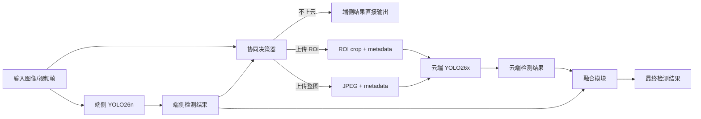

# YOLO26 端云协同目标检测操作说明

## 1. 系统定位

本系统面向“端侧需要实时响应，但轻量模型容易误检、漏检、分类错误”的目标检测场景。当前演示端侧固定运行训练 Current+MAUR 时使用的 `YOLO26n`，云端运行 `YOLO26x`；启动预检会校验端测权重的名称和 SHA256，防止特征分布错配。

> 第 3～4 节保留早期 YOLO26s + 线性学习器实验作为历史参考；当前现场演示使用 Current 四动作学习器与 MAUR 融合，不复用旧权重或旧指标。

系统目标不是简单追求最高 mAP，而是在以下约束之间取平衡：

```text
检测精度 / 上传带宽 / 网络 RTT / 云端 GFLOPs / 端侧实时性
```

## 2. 总体架构



端侧职责：

- 运行经哈希校验的 `YOLO26n` 完成实时检测。
- 计算图像复杂度、检测框置信度、目标面积、贴边程度、检测覆盖率等协同特征。
- 运行规则策略或学习型上传策略。
- 编码 JPEG，发送整图或 ROI 到云端。
- 接收云端结果并融合。

云端职责：

- 运行 `YOLO26x` 作为强模型复核器。
- 根据请求 metadata 中的 `cloud_imgsz` 动态选择推理分辨率。
- 返回检测框、类别、置信度和推理耗时。

通信模块职责：

- HTTP POST `/infer`。
- payload 是 JPEG 字节，metadata 包含 `request_id`、`image_id`、`roi_xyxy`、`cloud_imgsz`、上传类型等。
- 当前工程可本地 HTTP、远程 HTTP，也可通过 SSH tunnel 转发。

## 3. 决策逻辑

当前支持两类上传决策。

### 3.1 规则策略

规则策略不需要训练，适合冷启动和兜底。它根据端侧结果触发上传：

```text
低置信框 -> ROI 上传
小目标/贴边目标 -> ROI 上传并扩大上下文
周期关键帧 -> 整图上传
复杂但检测稀疏 -> 整图上传
尺度不稳定 -> 整图上传
```

规则策略优点是可解释、跨域退化平滑；缺点是阈值人工设定，上限有限。COCO full 上规则激进点为 `mAP50-95=0.5486`，低于学习器。

### 3.2 学习型上传策略 v2

学习器是轻量线性策略，不是重新训练 YOLO。它包含：

- frame probability head：判断整图上云是否可能带来收益。
- ROI probability head：判断某个 ROI 上云是否可能带来收益。
- frame/ROI value head：估计归一化收益大小。

训练标签来自 `YOLO26s`、`YOLO26x` 和 GT 的对比：

```text
utility = TP - fp_penalty * FP
gain = utility(after cloud fusion) - utility(edge only)
```

在线打分近似为：

```text
score = P(gain > 0 | features) * E[gain | features] - lambda * payload_cost
```

如果 score 过阈值，则上传；否则保留端侧结果。这个形式等价于在精度收益和通信成本之间做拉格朗日式权衡。

## 4. 当前推荐工作点

远程 COCO full v2 在 `train2017` 训练学习器、`val2017` 验证。修复了 COCO segmentation polygon label 误按 bbox 解析的问题。

基线：

| 模式 | Precision | Recall | mAP50 | mAP50-95 |
| --- | ---: | ---: | ---: | ---: |
| Edge-only YOLO26s | 0.6913 | 0.5781 | 0.6346 | 0.4733 |
| Cloud-only YOLO26x | 0.7383 | 0.6700 | 0.7327 | 0.5656 |
| Edge + full-frame cloud fusion upper | 0.9993 | 0.9399 | 0.9695 | 0.8008 |

候选工作点：

| 策略 | mAP50-95 | 上传图像比 | KB/image | GFLOPs/image | E2E@10Mbps |
| --- | ---: | ---: | ---: | ---: | ---: |
| Rule aggressive | 0.5486 | 0.6406 | 22.94 | 168.1 | 84.1 ms |
| Learned v2 f0.50/r0.05 | 0.5918 | 0.5656 | 34.90 | 98.7 | 85.4 ms |
| Learned v2 f0.60/r0.08 | 0.5829 | 0.4248 | 26.55 | 79.8 | 71.7 ms |
| Learned v2 f0.70/r0.10 | 0.5704 | 0.2442 | 15.87 | 55.6 | 49.9 ms |
| Learned v2 f0.80/r0.10 | 0.5518 | 0.0920 | 6.28 | 35.2 | 32.1 ms |

默认推荐：

```text
综合默认: Learned v2 f0.60/r0.08 cloud512
精度优先: Learned v2 f0.50/r0.05 cloud512
弱网优先: Learned v2 f0.70/r0.10 cloud512
```

## 5. 如何运行

### 5.1 推荐：本机端侧 + 远程服务器云端

首次在本机 `yolo26` 环境安装演示依赖：

```bash
/absolute/path/to/envs/yolo26/bin/python -m pip install "gradio>=5,<6" pytest
```

服务器和本机都可复制配置模板，真实地址与设备配置不要写回仓库：

```bash
cp examples/YOLO26-Edge-Cloud/demo.env.example examples/YOLO26-Edge-Cloud/demo.env
```

服务器默认只监听 `127.0.0.1`，启动云端：

```bash
bash examples/YOLO26-Edge-Cloud/start_cloud.sh
```

本机建立 SSH 隧道（请替换用户、服务器和 SSH 端口）：

```bash
ssh -N -L 8765:127.0.0.1:8765 -p SSH_PORT USER@SERVER
```

随后在本机启动 UI。脚本会先检查 Python 依赖、端侧模型、策略文件和云端 `/health`：

```bash
bash examples/YOLO26-Edge-Cloud/start_edge_demo.sh
```

浏览器打开 `http://127.0.0.1:7860`，依次演示：

1. `仅端侧`：断开云端也能运行，展示本机 YOLO26n 基线。
2. `仅云端`：每帧上传整图，展示带宽和远程时延上界。
3. `学习器协同`：展示不上云、ROI 和整图决策，以及概率、预期收益、流量、RTT 和融合结果。

UI 运行目录默认生成：

```text
runs/edge_cloud/gradio_demo/events.jsonl
runs/edge_cloud/gradio_demo/summary.json
runs/edge_cloud/gradio_demo/demo_report.md
```

如果必须在受信任局域网内直连，可在服务器的 `demo.env` 中设置 `CLOUD_HOST=0.0.0.0`，并把本机
`CLOUD_URL` 改为服务器地址。当前服务没有鉴权，不能直接暴露到公网。

### 5.2 手工启动

从仓库根目录进入 `yolo26` 环境：

```bash
conda activate yolo26
cd /home/111_wcy/work/yolo26/ultralytics-main
```

启动云端：

```bash
python examples/YOLO26-Edge-Cloud/cloud_server.py \
  --model yolo26x.pt \
  --host 127.0.0.1 \
  --port 8765 \
  --imgsz 640 \
  --conf 0.001 \
  --device 0
```

运行 Gradio：

```bash
python examples/YOLO26-Edge-Cloud/gradio_demo.py \
  --edge-model yolo26n.pt \
  --cloud-url http://127.0.0.1:8765/infer \
  --policy-path examples/YOLO26-Edge-Cloud/policies/current_maur_v2/manifest.json \
  --learned-cost-weight 0.02 \
  --cloud-imgsz 640 \
  --inbrowser
```

如果云端在远程服务器，本地可以先建立 SSH 隧道：

```bash
ssh -L 8765:127.0.0.1:8765 -p 10022 111_wcy@10.193.114.121
```

然后本地 Gradio 仍然访问：

```text
http://127.0.0.1:8765/infer
```

## 6. 结果文件

关键远程结果目录：

```text
runs/edge_cloud/learned_policy_coco_full_v2_20260424_1225/
runs/edge_cloud/summary_coco_full_v2_final_20260424/strategy_summary.csv
runs/edge_cloud/cost_coco_full_v2_final_20260424/cost_analysis.csv
```

本地已同步：

```text
runs/edge_cloud/learned_policy_coco_full_v2_20260424_1225/learned_upload_policy.json
runs/edge_cloud/summary_coco_full_v2_final_20260424/strategy_summary.csv
runs/edge_cloud/cost_coco_full_v2_final_20260424/cost_analysis.csv
```

## 7. 为什么比普通 ROI+云复核更合理

普通 ROI 复核主要修正端侧已有框，天然难以解决漏检；如果加入固定关键帧，又会导致大量低价值整图上传。本方案的学习器直接估计“上云是否能提升检测效用”，并把上传代价放进决策函数，所以能同时处理：

- 端侧已有框不可靠时的 ROI 复核。
- 端侧漏检风险较高时的整图复核。
- 高带宽/低带宽下不同阈值工作点切换。
- 视频流中通过 temporal memory 抑制重复上传。

从 COCO full 结果看，v2 学习器在更少上传和更少 GFLOPs 下明显超过规则策略，说明它不是单纯增加云端调用，而是在更有效地选择上云样本。
