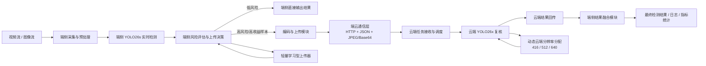
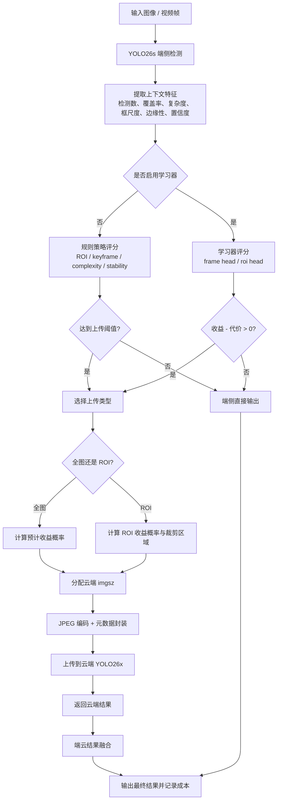

# YOLO26 端云协同目标检测系统设计说明

## 1. 设计目标

本系统面向“端侧实时检测 + 云端按需复核”的目标检测场景。端侧部署 `YOLO26s`，负责低时延连续检测；云端部署 `YOLO26x`，负责对高风险样本进行进一步分析，以在可控上传量、时延和云端算力开销下提升整体检测精度与鲁棒性。

系统优化目标不是单纯追求最高精度，而是在以下多目标约束下寻找合理工作点：

```text
maximize   DetectionQuality
subject to EdgeLatency, UploadBandwidth, CloudCompute, ResponseDelay
```

在工程上，对每个候选上云样本，系统实际求解的是一个近似的收益-代价平衡：

```text
score(x) = P(cloud upload improves detection | x) - lambda * estimated_payload_KB(x)
```

其中：

- `P(cloud upload improves detection | x)`：样本上云后带来检测收益的概率；
- `estimated_payload_KB(x)`：预计上传代价；
- `lambda`：上传成本权重。

这一定义使系统从“规则触发上传”转化为“收益约束下的选择性卸载”。

## 2. 系统架构图



## 3. 模块职责划分

### 3.1 端侧检测模块

端侧模块负责：

- 使用 `YOLO26s` 做实时检测；
- 生成检测框、类别、置信度、目标尺度、覆盖率、场景复杂度等信息；
- 根据规则或学习器评估“当前样本是否值得上云”；
- 对需要上云的样本执行裁剪、压缩、封装和发送；
- 接收云端复核结果并进行结果融合。

端侧的核心原则是：**默认本地闭环，只有高价值样本才上云**。这保证了系统具备实时性基础。

### 3.2 云端检测模块

云端模块负责：

- 接收端侧上传的全图或 ROI；
- 使用 `YOLO26x` 对上传样本进行高精度复核；
- 返回云端检测框、类别、置信度、请求延迟等信息；
- 支持按请求动态切换 `cloud_imgsz`，实现按样本价值分配云端计算资源。

云端不是替代端侧，而是作为**稀缺高精度资源**参与局部纠错。

### 3.3 端云协同与传输模块

端云协同模块负责：

- 上传触发决策；
- 上传类型选择：全图、ROI、proposal、tile；
- 压缩编码与 payload 控制；
- 请求级元数据管理；
- 云端结果回传后的融合与统计；
- 上传比例、带宽、GFLOPs、时延等系统级成本分析。

本系统中，真正决定系统是否有效的，不是“有没有云端模型”，而是**何时上传、上传什么、给云端分配多少计算**。

## 4. 决策流程图



## 5. 核心创新点归纳

### 创新点 1：从固定规则上传，升级为收益驱动的学习型上传决策

普通 ROI+云复核方法通常依赖固定阈值，例如“低置信框就上传”“每 N 帧上传一次”。这种方式的问题是：

- 无法判断某次上传是否真的会改进最终检测结果；
- 很容易上传大量低价值样本；
- 在不同场景、不同带宽条件下泛化较差。

本系统引入轻量学习型上传器，直接学习：

```text
什么样的样本上云之后最可能带来 mAP 提升
```

并将上传成本纳入决策目标。这样，系统不再只看“不确定性”，而是看“不确定性是否值得花代价交给云端处理”。

### 创新点 2：分离 frame-level 与 ROI-level 两类上传决策

本系统不是只做一个统一上传评分器，而是拆成两类：

- `frame head`：判断整张图是否值得云端全图复核；
- `roi head`：判断单个 ROI 是否值得云端局部复核。

这样做的理论依据是：**全图上传与 ROI 上传的收益机制不同**。

- 全图上传更擅长补漏检；
- ROI 上传更擅长纠正误检、分类错误和局部定位误差。

因此分头建模比单一评分器更合理，也更符合实际任务分工。

### 创新点 3：把云端计算量也纳入协同决策，提出动态云端分辨率分配

传统端云系统默认“上云就全精度跑一次”，但这会造成两个问题：

- 云端算力浪费；
- 弱收益样本占用和高收益样本相同的复核资源。

本系统进一步提出：**上传决策与云端算力分配联合建模**。

对于学习器认为收益边际较低的样本，云端用 `416`；
对于高价值样本，云端用 `512`；
必要时也可扩展到 `640`。

这使系统从“是否上云”进一步升级为：

```text
是否上云 + 上云后给多少云端计算
```

这是普通 ROI+云复核方案通常没有显式建模的。

### 创新点 4：实验评价从精度单指标，扩展到精度-时延-上传量-计算量联合评价

本系统明确将以下指标统一纳入实验：

- Precision / Recall / mAP50 / mAP50-95；
- 上传任务数、上传图像比例、Payload MB、KB/image；
- 端侧与云端时延；
- Edge GFLOPs / Cloud GFLOPs / System GFLOPs；
- 不同网络条件下的 blocking latency。

这样得到的结论更有说服力，因为它不只是“精度提升了多少”，而是“在多少代价下提升了多少”。

## 6. 实验结果总表

### 6.1 单模型上下限

| 模型/模式 | Precision | Recall | mAP50 | mAP50-95 |
| --- | ---: | ---: | ---: | ---: |
| YOLO26s 端侧部署阈值 | 0.7535 | 0.6100 | 0.7196 | 0.5995 |
| YOLO26x 全图云端上限 | 0.7875 | 0.7262 | 0.7939 | 0.6689 |

说明：端云协同系统的目标不是超过云端全图上限，而是在远低于全上传成本的条件下尽可能逼近 `0.6689`。

### 6.2 规则策略演进

| 策略 | Recall | mAP50-95 | 上传任务 | Payload MB |
| --- | ---: | ---: | ---: | ---: |
| ROI + keyframe baseline | 0.6225 | 0.6148 | 52 | 0.450 |
| Risk-aware fusion | 0.6316 | 0.6182 | 52 | 0.450 |
| Relaxed complexity probe | 0.6297 | 0.6189 | 72 | 2.095 |
| Risk + complexity | 0.6380 | 0.6221 | 72 | 2.095 |
| Adaptive ROI + risk + relaxed complexity | 0.6370 | 0.6241 | 72 | 2.083 |
| Adaptive ROI + risk + aggressive complexity | 0.6438 | 0.6250 | 91 | 3.345 |

结论：规则策略能提升精度，但随着策略变复杂，上传和云端开销迅速上升，性价比开始变差。

### 6.3 学习器与成本优化总表

| 策略 | Precision | Recall | mAP50-95 | 上传图像比 | KB/image | System GFLOPs/image | E2E@10Mbps |
| --- | ---: | ---: | ---: | ---: | ---: | ---: | ---: |
| Edge-only YOLO26s | 0.7535 | 0.6100 | 0.5995 | 0.0000 | 0.00 | 22.8 | 端侧本地 |
| 规则最佳 aggressive | 0.7730 | 0.6438 | 0.6250 | 0.6250 | 26.76 | 171.8 | 155.5 ms |
| Learned v1, thr=0.70, cloud512 | 0.8076 | 0.6519 | 0.6332 | 0.2656 | 15.37 | 58.5 | 80.6 ms |
| Learned v2, thr=0.45, cloud512 | 0.7744 | 0.6509 | 0.6325 | 0.2812 | 16.66 | 60.5 | 69.8 ms |
| Learned v1, thr=0.60, cloud640 | 0.7943 | 0.6967 | 0.6478 | 0.4297 | 24.89 | 112.9 | 105.3 ms |
| Learned v1, thr=0.60, cloud512 | 0.7877 | 0.6813 | 0.6514 | 0.4297 | 24.89 | 80.5 | 104.2 ms |
| Learned v1, thr=0.60, cloud416 | 0.7999 | 0.6667 | 0.6443 | 0.4297 | 24.89 | 60.9 | 100.4 ms |
| Learned v1, thr=0.60, cloud512 + JPEG q60 | 0.8083 | 0.6700 | 0.6407 | 0.4297 | 20.87 | 80.5 | 100.2 ms |
| Learned v1, thr=0.60, adaptive 416/512, switch=0.80 | 0.8055 | 0.6771 | 0.6538 | 0.4297 | 24.89 | 67.6 | 98.0 ms |
| **Learned v1, thr=0.60, adaptive 416/512, switch=0.75** | **0.8101** | **0.6765** | **0.6555** | **0.4297** | **24.89** | **71.6** | **101.5 ms** |

### 6.4 结果结论表述

可以将当前实验结论概括为：

1. 相比端侧单独部署 `YOLO26s`，端云协同最优方案将 `mAP50-95` 从 `0.5995` 提升到 `0.6555`，绝对提升 `+0.0560`。
2. 相比规则式最佳方案，学习型方案在更低系统 GFLOPs 下取得更高精度：
   - 规则最佳：`0.6250 mAP50-95`，`171.8 GFLOPs/image`
   - 学习最优：`0.6555 mAP50-95`，`71.6 GFLOPs/image`
3. 相对全图云端 `YOLO26x` 上限 `0.6689`，当前最优端云协同方案已经补足约 `80%` 的精度差距，同时只上传 `42.97%` 的图像。
4. 对弱网部署更友好的平衡点是 `Learned v1, thr=0.70, cloud512`，其 `mAP50-95=0.6332`，上传比仅 `26.56%`，`10Mbps` 下时延约 `80.6 ms`。

## 7. 为什么这套方案比普通 ROI+云复核更合理

### 7.1 普通 ROI+云复核的典型局限

普通方案通常是：

- 端侧检测；
- 对低置信框做 ROI 裁剪；
- 送云端复核；
- 用云端结果修正端侧结果。

这种方法虽然直观，但存在四个明显问题：

1. **只会修框，不擅长补漏检**  
   如果端侧根本没检出来，普通 ROI 方案通常没有 ROI 可传，漏检问题仍然存在。

2. **过度依赖手工阈值**  
   低置信阈值、ROI 扩张比例、关键帧间隔都要手动调，场景变化后容易失效。

3. **上传价值不可控**  
   很多上传的 ROI 实际上并不会提升最终指标，但仍然消耗带宽与云端推理资源。

4. **云端资源分配粗糙**  
   一旦上云，所有样本常常都用同样的高代价复核配置，没有体现样本价值差异。

### 7.2 本方案的改进逻辑

本方案比普通 ROI+云复核更合理，主要体现在以下几点：

#### 第一，系统能同时处理“误检、分类错、漏检”三类问题

- ROI 上传：更适合纠正误检和分类错误；
- 全图上传：更适合补漏检；
- 风险感知融合：控制云端结果插入强度，避免云端弱框反过来污染结果。

也就是说，本方案不是单一纠错机制，而是按错误类型分工。

#### 第二，上传决策从“看不确定”升级为“看收益是否值得”

普通方法只看置信度或规则信号；本方案显式学习“上云能否真正改善结果”。这使上传决策更接近真实优化目标，而不是仅凭启发式假设。

#### 第三，系统同时优化通信成本和云端计算成本

普通 ROI+云复核多半只考虑上传带宽。本方案进一步考虑：

- 上传 KB；
- 云端 GFLOPs；
- 端到端时延；
- 不同网络环境下的工作点变化。

因此，这套方案更接近真实部署，而不是只在理想条件下追求实验指标。

#### 第四，系统具备清晰的可扩展性

这套框架后续可以自然扩展到：

- 更复杂的学习器；
- 多级云端模型；
- 网络状态感知上传；
- 时序记忆与视频级决策；
- 开集检测或多模态复核。

普通 ROI+云复核往往是若干规则的堆叠，扩展到更复杂场景时容易失控，而本方案已经具备统一的优化目标和可扩展决策接口。

## 8. 当前推荐工作点

### 工作点 A：精度优先

- 策略：`Learned v1, thr=0.60, adaptive 416/512, switch=0.75`
- 特点：当前最优精度；
- 适用：对误检漏检更敏感，且链路和云端预算尚可的场景。

### 工作点 B：部署优先

- 策略：`Learned v1, thr=0.70, cloud512`
- 特点：上传比例更低、GFLOPs 更低、时延更短；
- 适用：野外部署、弱网、边云资源受限场景。

## 9. 后续最值得做的三项工作

1. 用独立训练集/验证集重新训练并验证学习器，避免 COCO128 原型实验中的同集偏差。
2. 将网络状态感知纳入上传器，把 `uplink_mbps`、RTT、队列长度直接作为决策输入。
3. 引入视频时序记忆，在连续帧场景中减少重复上传，进一步降低带宽与云端重复计算。
